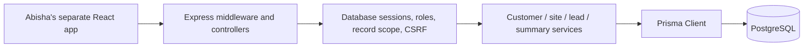
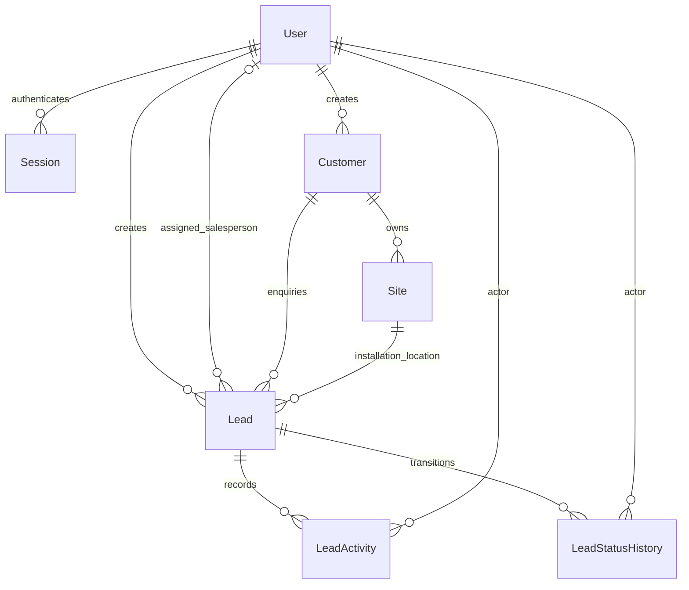
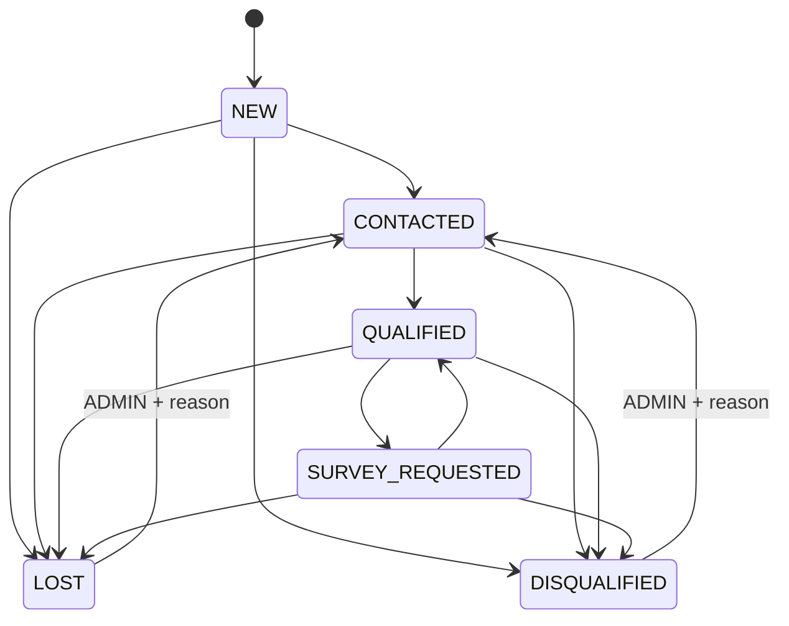

# M01 technical documentation

## Architecture and scope

The backend is a single Express 5 application. The public boundary is JSON over `/api`; authenticated CRM controllers delegate business rules to services and services call Prisma inside PostgreSQL transactions. Zod is the input boundary. No competing frontend, survey workflow or unrelated module is included.

## Entity relationships

Prisma models map to quoted PostgreSQL tables with the same names: `User`, `Session`, `Customer`, `Site`, `Lead`, `LeadActivity`, `LeadStatusHistory`. Customer ownership is sales ownership, not a separate login identity. There is only one User table and one authentication system.

## Fields, SQL types and constraints

Every primary key is PostgreSQL UUID, generated by Prisma `uuid()` during insertion. Customer `CUS-<uuid>` and Lead `LED-<uuid>` references are separately generated, unique 40-character codes. They are opaque, not sequential or meaningful identifiers. UUIDs reduce guessability but do not replace authorization.

| Table | Key fields and constraints |
|---|---|
| User | Unique lowercase email; name <=120; role enum; active flag; required password hash; createdAt/updatedAt. |
| Session | Unique 64-character SHA-256 token hash; User FK; createdAt; absolute expiresAt. |
| Customer | Required name, type enum, phone and E.164 normalizedPhone; optional email/company/notes; owner FK; archival fields; positive version; timestamps. Phone is not unique. |
| Site | Customer FK; site name; required addressLine1/city/state/postalCode/country; optional addressLine2/landmark/notes; paired nullable latitude/longitude; positive version; timestamps. Unique `(id,customerId)`. |
| Lead | Customer FK; composite Site FK `(siteId,customerId)`; source/status/priority/system enums; `numeric(10,3)` capacity; `numeric(14,2)` bill; nullable salesperson FK; creator FK; qualification notes/follow-up/closed reason; positive version; timestamps. |
| LeadActivity | Required Lead/User FKs, activity enum, description <=5000, server timestamp. No edit/delete API. |
| LeadStatusHistory | Required Lead/User FKs, nullable prior status, new status, nullable reason <=2000, server timestamp. No edit/delete API. |

Customer and Lead references/email uniqueness use database constraints, so racing writes cannot bypass them. All CRM foreign keys restrict deletion; only Session→User cascades. No hard-delete CRM route exists. Database enum values reject unsupported statuses/types even when bypassing HTTP validation.

Additional SQL CHECK constraints enforce positive versions/capacity, nonnegative money, E.164 phone shape, lowercase emails, valid coordinate range and pairing, archival timestamp consistency, and terminal lead reason/follow-up consistency. Application validation is stricter (country/phone metadata, precision limits, business transitions and assignment role). Assignment role and permitted workflow transitions are service rules, not SQL triggers; direct SQL access must remain restricted to trusted operators.

Decimal API inputs for capacity/bill are strings; Prisma Decimal serializes output to strings without guaranteed trailing zero padding. Coordinates are JSON numbers on input and decimal strings on output. Dates are timezone-aware SQL `timestamptz(3)` and serialized to UTC ISO strings. No currency conversion exists; monthly bills are interpreted in the deployment's single business currency, to be agreed with Abisha before display.

## Indexes and search

- Unique indexes: User.email, Session.tokenHash, customer/lead reference, Site `(id,customerId)` and every primary key.
- Customer: normalized phone and email for matching; `(createdById,isArchived)`, `(isArchived,createdAt,id)` and type for scoped lists.
- Site: `(customerId,createdAt,id)` for customer locations.
- Lead: customer, `(siteId,customerId)`, `(status,createdAt,id)`, `(assignedToId,status)`, creator, source, priority and follow-up time.
- Activity/history: `(leadId,createdAt,id)` for timelines and actor indexes for references.
- Session: user and expiry indexes.
- `pg_trgm` GIN indexes on customer name/reference/company, site name, lead reference and qualification notes support contains/ILIKE searches. Phone/email have ordinary B-tree indexes for exact duplicate matching; contains searches on email/original phone can still scan. Very short search terms may not benefit from trigram indexes. Real query plans need a later approved database review.

The initial migration enables `pg_trgm` before creating these indexes. Managed PostgreSQL must allow this extension or have an operator install it first. This is documented rather than silently removing search indexes.

## API inventory

All paths start with `/api`. Success is `{data: ...}`, lists add `{pagination: ...}`, and customer create/update adds `{warnings: []}`. Errors are `{error: {code,message,details?,requestId}}`. See the complete frontend contract for every field/example.

| Method | Path | Result |
|---|---|---|
| GET | `/health` | Process liveness, no DB access |
| POST | `/auth/login` | Session cookie, safe user, CSRF token, expiry |
| POST | `/auth/logout` | Revoke current session |
| GET | `/auth/me` | Safe user and recoverable CSRF token |
| POST / GET | `/customers` | Create / paginated search |
| GET / PATCH | `/customers/:id` | Detail / versioned edits |
| POST | `/customers/:id/archive` | Safe archival |
| POST / GET | `/customers/:id/sites` | Create / paginated site list |
| GET / PATCH | `/sites/:id` | Site details / versioned edits |
| POST / GET | `/leads` | Create enquiry / paginated search |
| GET / PATCH | `/leads/:id` | Lead detail / versioned edits and scheduling |
| POST | `/leads/:id/status` | Validated state transition |
| POST | `/leads/:id/assign` | Versioned assignment |
| POST / GET | `/leads/:id/activities` | Append / paginated real activities |
| GET | `/leads/:id/history` | Paginated status history |
| GET | `/crm/summary` | Real scoped metrics and follow-up previews |
| GET | `/crm/salespeople` | ADMIN-only paginated active SALES picker |

Customer/lead/site/activity creation returns 201. Other successful endpoints return 200. No DELETE endpoints or PUT replacement semantics are provided. POST is not idempotent; no idempotency-key contract is offered. Never blindly retry a creation after an unknown network outcome. Re-fetch/search to reconcile first. Versioned updates also should be re-read after uncertain outcomes; the same version cannot successfully apply twice.

## Permission matrix

| Operation | ADMIN | SALES | TECHNICIAN / WAREHOUSE / SUPPORT / FINANCE |
|---|---|---|---|
| Login / me / logout | Own session | Own session | Own session |
| Customer read/edit/site management | All active records; archived read | Created customers or customers with a visible lead (assigned to self or own unassigned); archived read | Denied |
| Lead read/edit/activity/history | All; terminal editing restrictions apply | Assigned-to-self, or created-by-self while unassigned | Denied |
| Assignment | Active SALES user or null | Self only, within existing lead scope | Denied |
| Close lead | With reason | Within scope, with reason | Denied |
| Reopen LOST/DISQUALIFIED | CONTACTED only, with reason and active customer | Denied | Denied |
| Customer archive | All, no active leads | Within customer scope, no active leads | Denied |
| Salesperson directory | Allowed | Denied | Denied |
| Provision user | Trusted database operator CLI, no HTTP endpoint | No HTTP endpoint | No HTTP endpoint |

Archival checks all linked leads, not just the caller's visible subset. Inaccessible resource IDs return 404, avoiding unnecessary existence disclosure. Lead reassignment removes former-owner lead access but customer creators retain access to customer/site data. This is an explicit sales-ownership policy, not a per-field privacy grant.

## Workflow and business rules

Qualification requires nonempty qualification notes stored before the transition. Generic edits cannot clear notes on QUALIFIED/SURVEY_REQUESTED records. Closing requires a reason and clears nextFollowUpAt. Reopening clears the current closedReason but preserves it in status history. Same-state transitions fail. Archived customers block every subordinate write, including reopening; no unarchive route exists in M01.

Lead customer is immutable. Site may change on an open lead only to another site of the same customer. A site itself cannot be moved to another customer. Assigned users must be active SALES, never ADMIN/TECHNICIAN by convenience. Original and normalized phone are both retained; a shared household/company number does not force a customer merge. Duplicate warnings are limited to visible records to avoid leaking other customers.

Follow-up dates must include timezone; newly scheduled dates must be future instants. Existing dates naturally become overdue. FOLLOW_UP activity logging is a record of interaction, while nextFollowUpAt is the current schedule. This module does not send reminders.

## Dashboard definitions

Every query uses the caller's record scope and a single serializable snapshot:

- totalCustomers: visible **nonarchived** customer count.
- totalLeads: all visible leads, including lost/disqualified and those belonging to archived customers.
- newLeads, qualifiedLeads, surveyRequests, lostLeads: counts in the named current statuses.
- leadsByStatus/source: only groups actually present; an empty database gives `[]`.
- upcomingFollowUps: open leads scheduled between asOf and upcomingUntil (next seven rolling days, inclusive), total plus first ten items.
- overdueFollowUps: open leads before asOf, total plus first ten items.
- qualifiedEver: visible leads with at least one persisted QUALIFIED/SURVEY_REQUESTED history entry; counted once per lead.
- qualificationConversionRate: qualifiedEver / totalLeads × 100, rounded to two decimals; zero when denominator is zero. This is historical qualification share, not completed-project or survey approval rate.

Use `GET /leads?followUp=upcoming|overdue&page=...` for the full follow-up list. Subsequent requests have a new asOf, so an item at the time boundary may move lists.

## Transaction boundaries and errors

`atomic` wraps scoped reads/checks and their writes in PostgreSQL SERIALIZABLE transactions. Required caller version and write-predicate version prevent stale changes to Customer/Site/Lead. Status update+history, creation+initial history+activity, field edit+audit activity and assignment+audit activity are atomic. No read-then-write operation is intentionally split across separate transactions.

PostgreSQL may abort one conflicting transaction; P2034 is HTTP 409 CONCURRENT_UPDATE. The client refreshes the record and makes a deliberate decision. A previously stale version produces 409 VERSION_CONFLICT. Prisma P2025 maps to 404 if a conditional write finds no record; simultaneous conflicts at SERIALIZABLE normally surface as P2034. No distributed locking or unbounded retry loop is used.

Other errors: INVALID_CREDENTIALS/UNAUTHENTICATED (401), FORBIDDEN/CSRF_FAILED/ORIGIN_FORBIDDEN/ASSIGNMENT_FORBIDDEN/REOPEN_FORBIDDEN (403), NOT_FOUND (404), DUPLICATE_VALUE/REFERENCE_CONFLICT/CUSTOMER_ARCHIVED/ACTIVE_LEADS_EXIST/LEAD_CLOSED/INVALID_TRANSITION (409), VALIDATION_ERROR/SITE_CUSTOMER_MISMATCH/INVALID_SALESPERSON/REASON_REQUIRED/QUALIFICATION_REQUIRED/FOLLOW_UP_IN_PAST (422), RATE_LIMITED (429), INVALID_JSON (400), PAYLOAD_TOO_LARGE (413), UNSUPPORTED_MEDIA_TYPE (415), INTERNAL_ERROR (500).

## Security and operational limits

Trust boundaries are browser→API (PII, roles, IDs, cookies), API→PostgreSQL (integrity), and trusted operator→provisioning CLI (elevated credentials). Bound text/JSON size, rate limits, role/record scope, parameterized Prisma queries, no-store responses, Helmet, exact-origin CORS, trusted-Origin checks and session CSRF protect those boundaries. Login is protected by required trusted Origin and JSON, while authenticated mutations additionally require the per-session CSRF token. Safe GET requests cannot mutate business data.

Session tokens have 256 bits of entropy and are stored only as hashes in SQL. Cookies are host-only, HttpOnly, SameSite and Secure in production. Password scrypt parameters are fixed and salted. Authentication reads active state/current role each request; existing sessions do not retain stale roles. Database credentials remain deployment secrets. There is no hardcoded application secret. Request IDs are generated by the server; error logs avoid PII.

Before production: use TLS, narrowly scoped DB credentials, protected operator access, backups, migration review, an explicit retention policy for PII and backups, a shared rate-limit store for multiple processes, session-cleanup scheduling and approved runtime security tests. Current rate limiting is per-process memory and resets on restart. There is no CAPTCHA, password-reset flow, MFA, login-event audit table or full before/after customer/site audit. This is a functional M01 foundation, not a claim of completed production security certification.

Addresses, contact details, coordinates and free-text notes are personal/business information collected for customer acquisition and installation planning. Avoid unrelated sensitive details in free text. Archival preserves referential business history; it is not privacy erasure. Establish legal retention/deletion procedures before live personal data is used.

## Migration, verification and M02 handoff

Migration SQL is generated from an empty schema without a database connection; additional checks are explicit SQL. No database was reset, migrated, seeded or contacted for verification. Prisma client generation, schema validation and TypeScript checks are static; see `docs/VERIFICATION.md` for exact outcomes. Functional verification remains pending explicit permission and a disposable PostgreSQL environment.

M02 may later consume existing customer/site/lead identifiers and treat SURVEY_REQUESTED as a request only. It must add its own survey record, engineer assignment, access rules and technical findings after explicit M01 approval. M01 creates none of those models or routes.

Implementation references: [Prisma 6 transactions and concurrency](https://www.prisma.io/docs/orm/v6/prisma-client/queries/transactions), [Prisma 6 Client reference](https://docs.prisma.io/docs/orm/v6/reference/prisma-client-reference), [Express security guidance](https://expressjs.com/advanced/best-practice-security/). The pinned dependency versions and local source remain authoritative for this implementation.
