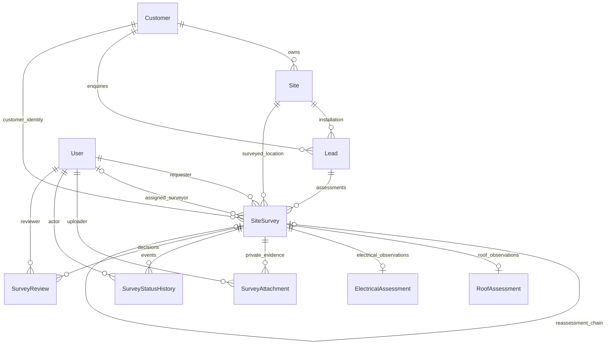
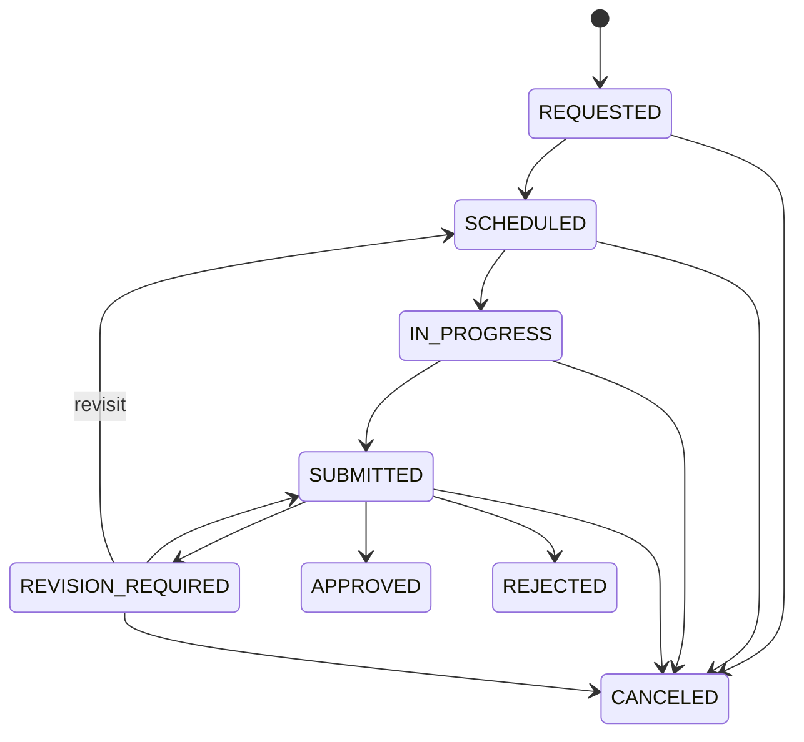

# M02 solar site survey — technical documentation

M03 integration update: the M02 approved-handoff logic is now exposed as `requireApprovedSurvey(tx,user,id)` for atomic reuse by the M03 caller; existing `approvedSurvey(user,id)` and its HTTP payload/permissions are unchanged. M03 is a dependent feature of unmerged M02 PR #2 at branch creation. See [M03 documentation](M03_SOLAR_CONFIGURATION_TECHNICAL_DOCUMENTATION.md); historical future-tense M03 notes below describe the original M02 boundary.

M02 records a real installation location's field observations and preliminary internal feasibility. It follows M01 commercial qualification and stops before M03 component selection/BOM/configuration. It does not calculate structural load certification, grant utility/government permission or claim commissioning.

## Architecture and relationships

Existing Express middleware → `createSurveyRouter` → strict Zod schemas → survey services → existing serializable Prisma transaction wrapper → PostgreSQL. Private evidence uses the injected `SurveyStorage` interface and a configurable local adapter; files are never publicly mounted.

The new six tables use UUID keys and restrictive foreign keys. SiteSurvey has explicit customer/site/lead relations and a composite FK to Lead `(id,siteId,customerId)`, guaranteeing exact ownership. Existing Lead gains only a redundant composite unique key and inverse relation. Existing User gains relations; there is no new identity table or SURVEYOR role.

SiteSurvey identity includes unique `SUR-<uuid>` reference, lead/site/customer IDs, immutable request notes/capacity snapshot, requester and assessment sequence/predecessor. Mutable draft fields contain assignment/visit planning and preliminary capacity/system/suitability/conditions. Positive version tracks every mutation. Roof/electrical child rows are one-to-one and carry created/updated timestamps; attachments/history/reviews are append-only and carry server creation timestamps. Decimal input/output policy matches M01: numeric observations/capacity use decimal strings; duration is integer minutes; timestamps require offsets and are stored as timestamptz(3).

Indexes cover unique references/predecessor, `(leadId,assessmentNumber)`, customer/site FKs, `(status,createdAt,id)`, `(assignedToId,scheduledAt)`, requester, survey timelines, actor/uploader/reviewer and one review per content version. SQL adds partial active/running unique indexes and the GiST appointment exclusion. Contains search on the new survey reference can scan; exact lookup is indexed, and related lead/site searches reuse M01's indexes. No measured runtime query-plan claim is made.

## Lifecycle, assignment and visits

All transitions record actor/time/reason/from/to/resulting version. Same-state events record reassignment, rescheduling, findings or uploads. There is no arbitrary status setter. APPROVED/REJECTED/CANCELED have no outgoing transition; reassessment creates a new linked row while preserving all prior data/reviews. A lead has at most one active survey; it may have multiple terminal historical assessments.

- Only an authorized ADMIN/SALES user can create an initial request against an active customer's M01 lead currently SURVEY_REQUESTED. A QUALIFIED lead alone is not eligible. Site must equal the existing lead's site; customer is derived server-side.
- Only ADMIN may request reassessment, referencing the latest terminal predecessor. Unique predecessor and lead/assessment-number constraints prevent branching or accidental duplicates. Request notes explain the new assessment. No old row is copied into an approved state.
- ADMIN assigns existing active TECHNICIAN users. Reassignment is allowed while REQUESTED, SCHEDULED or REVISION_REQUIRED, with a reason/history. Scheduled reassignment checks the new technician's existing appointments. Revision reassignment clears the old completed slot/visit state; the new assignee may correct findings directly during revision or receive a new visit schedule.
- ADMIN schedules/reschedules a future UTC instant with a 15–480 minute duration. End time is computed from that duration. Half-open intervals permit exactly adjacent appointments. A SQL exclusion constraint prevents simultaneous conflicting writes even across processes.
- Only the assigned technician starts within `[scheduledAt,scheduledEndAt)`. A missed appointment must be rescheduled; early starts are not permitted. Another ongoing visit prevents starting a second one, even if the earlier planned interval has elapsed. SQL also enforces one IN_PROGRESS row per technician.
- Visit statuses are NOT_SCHEDULED, CONFIRMED, IN_PROGRESS, COMPLETED and CANCELED. Submit marks the visit completed; correcting returned findings need not involve another visit. No-show is represented operationally by a missed scheduled window requiring rescheduling/cancellation; no separate NO_SHOW endpoint exists.
- Availability checks one active technician and a positive window of at most 31 days. It returns paginated overlapping confirmed appointments, ongoing-visit count and active survey workload. `available` is conservatively false while any visit is ongoing. It is a lookup, not a reservation; final booking always repeats checks and relies on SQL exclusion. Shift calendars, leave and travel are outside this implementation.

## Authorization

| Action | ADMIN | SALES | TECHNICIAN | WAREHOUSE / SUPPORT / FINANCE |
|---|---|---|---|---|
| Survey list/detail/history/evidence/reviews/summary | All | Existing M01 lead scope | Currently assigned surveys | Denied |
| Initial request | Eligible lead | Eligible visible lead | Denied | Denied |
| Reassessment | Latest terminal predecessor | Denied | Denied | Denied |
| Assign/schedule/reschedule/cancel | Allowed in valid state | Denied | Denied | Denied |
| Start/findings/uploads/submit | Denied | Denied | Assigned only, valid lifecycle | Denied |
| Approve/reject/return revision | SUBMITTED only | Denied | Denied | Denied |
| Surveyor directory | Allowed | Denied | Denied | Denied |
| Availability | Any active technician | Denied | Self only | Denied |
| Approved M03 handoff read | Within survey scope; eligible/latest/approved only | Same | Same | Denied |

ADMIN coordinates/reviews but cannot replace the assigned technician's findings via these endpoints. The SQL review guard also rejects the current assignee reviewing themselves. A technician is assigned explicitly by ADMIN; the frontend's lowercase `surveyor` role is not mapped to TECHNICIAN automatically. Its existing eight-role model remains a known frontend integration task. No frontend role string grants backend privileges.

Technicians remain denied direct general CRM routes. Survey details/snapshots expose the needed customer name/phone/reference and location/address/property access notes, not customer email/company/free-form CRM notes, salesperson pipeline or password/session data. Reassignment removes the former technician's survey access. Ownership is checked independently of UUID format on every read/write/download.

## Assessment and approval rules

Roof records describe RCC/METAL/TILE/OTHER, usable/mounting area (0–1,000,000 m², mounting <= usable), azimuth [0,360), tilt [0,90], shading NONE/LOW/MODERATE/HIGH, observations/obstructions, access/condition, mounting concerns, structural notes and recommendations. These broad sanity limits are not structural engineering validation. Unknown roof condition/access can be recorded explicitly; OTHER needs construction details. Structural specialist verification is a required boolean, not a computed certificate.

Electrical records distinguish CONNECTED/NOT_CONNECTED/UNKNOWN and SINGLE_PHASE/THREE_PHASE/UNKNOWN. Connected supplies require meter details. Panel presence drives panel evidence requirements. Cable run may be unknown (null) or 0–100,000 m; earthing/panel/safety/grid placement notes are observations, not tested electrical compliance. OFF_GRID recommendations require battery-placement considerations.

Technicians save decimal recommended capacity and ON_GRID/OFF_GRID/UNDECIDED recommendation, suitability UNASSESSED/SUITABLE/CONDITIONALLY_SUITABLE/NOT_SUITABLE, infeasibility reason, additional work, assumptions and feasibility notes. Requested capacity is copied from M01 at request time. No universal m²/kW formula, capacity estimate algorithm, component selection or BOM is implemented.

Submission requires both complete validated assessments, assessed suitability, decided system type, assumptions/feasibility notes and applicable evidence. Suitable/conditional sites need positive usable/mounting area and recommended capacity. NOT_SUITABLE needs an infeasibility reason and cannot be approved. Evidence is at least a roof photograph, meter photograph for connected grid, and panel photograph when a panel is present. Layout/support files are optional; photo categories accept image files only.

ADMIN reviews only SUBMITTED records. APPROVED requires the five main checklist acknowledgements: roof/electrical/evidence/assumptions reviewed and limitations acknowledged. Conditional feasibility additionally requires additionalWorkRequired and conditionalWorkAcknowledged. Specialist structural verification, electrical safety verification, HIGH shading, restricted/unsafe/unknown roof access, poor/unknown condition, or an ON_GRID recommendation without a known connected grid force explicit CONDITIONALLY_SUITABLE treatment and additional work before internal approval. Such an approval preserves unresolved actions; it does not claim those actions are completed.

REVISION_REQUIRED and REJECTED require nonempty review notes; checklist is optional for those decisions. Each decision stores its reviewed content version, full snapshot, actor, notes and checklist immutably. Revision can correct current findings, but earlier decision snapshots stay unchanged. Terminal assessments and their child findings/evidence cannot be edited/deleted through API or ordinary SQL writes protected by triggers.

## Private evidence storage

Uploads are **raw binary**, not JSON/base64/multipart. Authenticated technician sends a version/category/safe filename query and appropriate JPEG/PNG/PDF Content-Type plus Origin/CSRF. The route authorizes before buffering and rechecks after buffering/storage, preventing races with reassignment/submission. File size defaults to 5 MiB, configurable 1 KiB–10 MiB; each assessment allows 25 files. Upload limiter is 10 attempts per IP per 15 minutes in addition to the existing general limiter.

MIME/extension/signature must agree. SVG/HTML/executables/archives/office documents are not accepted. Photo categories accept JPEG/PNG, layout/support categories may also use PDF. Signature checks do not constitute malware scanning or full decoding. PDFs may contain active content; downloads are forced attachments with sandbox/no-sniff headers and must be scanned before wider production use.

Private local storage defaults to the operating user's `~/.solar-installation/survey-uploads`, outside the frontend repository. Run from backend/; configured roots inside its parent repository/public/build directories are rejected both lexically and after canonicalization. Never mount the private root in a web server. Keys are generated UUID filenames, independent of user names, opened exclusively. Read/cleanup paths validate containment and reject symlinks/nonfiles; no recursive cleanup is performed. Windows needs protected ACLs in addition to Node's POSIX mode requests. Back up file volume and database consistently.

Metadata stores survey/uploader/category/name/MIME/size/hash/private key/time. API metadata and review snapshots omit the storage key; there is no public object URL. Download checks survey and attachment ownership and verifies bytes against the stored digest/size. Reads have a hard 10 MiB ceiling so lowering the configurable new-upload limit does not invalidate previously accepted evidence. Filesystem and database are not atomically committed together: known rollback cleans the freshly-created object via a receipt; unknown commit outcome retains it and logs a reconciliation-required event. Partial filesystem failures/process crashes can leave orphans; operator reconciliation, quotas and retention remain documented operational work.

## API and errors

See `backend/docs/integration/M02_FRONTEND_API_CONTRACT.md` for exact types and examples. All paths use `/api/surveys`; JSON success/error/pagination match M01. Create/upload return 201, other successful operations 200. Binary retrieval is the documented response-format exception. No DELETE endpoint, public file-serving route, generic status update or frontend implementation is included.

Relevant 409 codes: VERSION_CONFLICT, SURVEY_IMMUTABLE, INVALID_SURVEY_TRANSITION, ACTIVE_SURVEY_EXISTS, REASSESSMENT_REFERENCE_REQUIRED, SURVEYOR_BUSY, ASSIGNMENT_LOCKED, SCHEDULING_LOCKED, OUTSIDE_VISIT_WINDOW, SURVEY_NOT_EDITABLE, NOT_SUBMITTED, SURVEY_NOT_APPROVED, SURVEY_SUPERSEDED, HANDOFF_NOT_ELIGIBLE, STORAGE_INTEGRITY_ERROR, ATTACHMENT_LIMIT, SURVEY_CONSTRAINT and the M01 SURVEY_SITE_LOCKED guard. Invalid request/evidence/completeness uses 422; forbidden role/ownership commands use 403 or scoped 404; malformed media/size uses 415/413; limits use 429. Existing auth and database error mapping is unchanged.

All changes require current integer version; approvedVersion identifies the submitted content version N, while its final approval row has version N+1. Retry after a conflict requires re-fetch and a deliberate action. Creation is not a general idempotency-key API; duplicate requests are constrained by one-active-per-lead and assessment numbering. Do not blindly repeat unknown-outcome writes.

## M01/M03 boundaries and migration status

M01 lead site changes are blocked once survey history exists, and lead status cannot leave SURVEY_REQUESTED while a survey is active. These narrow changes prevent existing live surveys becoming orphaned/ineligible. General M01 customer/site/lead/auth behavior is otherwise preserved. Customer/site descriptive edits remain possible in M01; immutable decision snapshots preserve the actual data/versions reviewed.

M03 must request `GET /api/surveys/:id/approved` and persist `{surveyId, approvedVersion, reviewId}` along with returned recommended capacity/system, conditions, assumptions and snapshot. The guard rejects nonapproved, superseded, archived-customer and no-longer-eligible-lead records. Historical reviews remain readable for audit, but do not imply current handoff eligibility. A future server-to-server M03 service should reuse `approvedSurvey` within an appropriate transactional boundary and add its own authorization; it must not infer approval from a client-supplied status string or pick any historical approved row.

Migration `20261031000200_m02_site_survey` is generated, additive and **not applied**. It does not update/delete existing business data; new tables are empty until real authorized requests. It requires btree_gist extension privileges and must retain M01's existing custom SQL checks/pg_trgm indexes. Custom trigger/exclusion SQL needs approved execution checks; Prisma validation alone cannot establish it works.

Static verification and file inventory: `backend/docs/M02_VERIFICATION.md`. No database connection, server, browser or runtime test was used for verification. Remaining production work includes approved functional/concurrency/upload/security testing, migration execution, storage permissions/quotas/backup/scanning/reconciliation, distributed rate limits and explicit frontend role/contract alignment. No M03 implementation is included.

Authoritative implementation references: [PostgreSQL range/exclusion constraints](https://www.postgresql.org/docs/15/rangetypes.html), [OWASP file upload guidance](https://cheatsheetseries.owasp.org/cheatsheets/File_Upload_Cheat_Sheet.html), [Prisma unsupported-feature migration guidance](https://www.prisma.io/docs/orm/prisma-migrate/workflows/unsupported-database-features). Local source and migration SQL define the implemented behavior.
