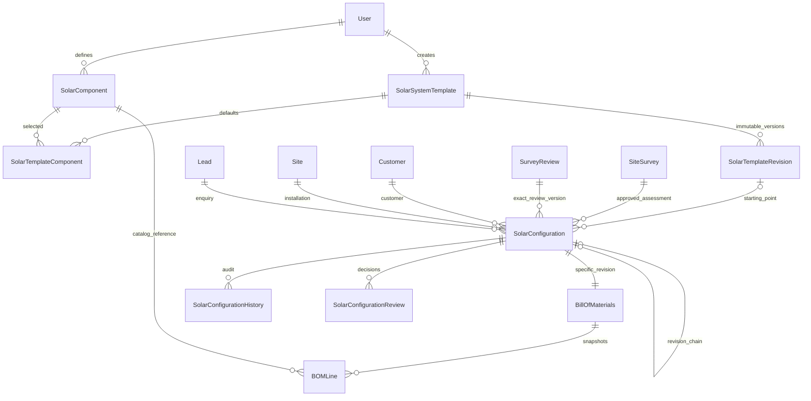

# M03 solar configuration and BOM — technical documentation

M03 converts the latest eligible internally approved M02 site survey into a proposed component configuration and estimated material BOM. It preserves M00–M02 and does not implement M04 inventory or later workflows. Existing M03/M04 React screens from main are preserved unchanged.

## Dependency and architecture

M02 PR #2 was open/unmerged when M03 started. Branch `codex/m03-solar-configuration` starts from M02 `136e62b`, with main `8728467` merged locally to preserve Abisha's newer frontend. M03 must not merge into main or apply its migration before M02. Its own code diff should be reviewed relative to that combined base, not mistaken for new M02/M04 frontend work.

Express `/api/solar` → existing sessions/roles/Origin/CSRF → strict Zod → modular catalog/configuration/BOM/review services → shared SERIALIZABLE Prisma transaction → PostgreSQL. M02 `requireApprovedSurvey` is reused within the same transaction and requires APPROVED, latest assessment, matching approval version/review, active customer and eligible SURVEY_REQUESTED lead. Configuration composite FKs independently retain matching customer/site/lead and exact survey review/version. No alternative authentication/identity table exists.

## Data design and versioning

Nine new models: SolarComponent, SolarSystemTemplate, SolarTemplateComponent, SolarTemplateRevision, SolarConfiguration, BillOfMaterials, BOMLine, SolarConfigurationHistory, SolarConfigurationReview. UUIDs and opaque unique SKU/template/configuration/BOM codes identify records. All FKs restrict deletion; references to survey identity/review use ON UPDATE RESTRICT. Additional unique composite keys on existing SiteSurvey and SurveyReview support those FKs without modifying business rows.

Component price is numeric(18,4); BOM quantity numeric(12,3); material line/header totals numeric(24,2); target/template kW numeric(10,3); calculated capacity/nominal energy numeric(24,6). Dates use timestamptz(3). A component/SKU and template/position occur once per relevant list; required quantities are minima and no implicit substitutions/conversions occur. Active state is soft archival; ADMIN may explicitly reactivate through PATCH. No approved header/line/configuration can be deleted or changed.

Template master version increments with every update/archive and appends an immutable full revision. Configurations store selected template ID/version and snapshot, so master changes cannot alter old customer records. Component SKU/category/unit are immutable; name/specifications/price/status may change with optimistic version. Config/BOM snapshots retain the exact selected component version/price/specification, even after catalog changes. Last catalog change reason is stored; this is not a full separate catalog edit-history table.

Configuration series/revisionNumber models business revisions; previousConfigurationId is unique to prevent branching. New proposals without a predecessor are separate alternatives. Revised records retain lead/site/customer but may select a newer approved survey and template. Configuration.version is optimistic edit/audit version; approvedVersion identifies reviewed submitted content N (approved row is N+1); BOM.version counts content regeneration; catalog/template versions identify their own definitions. Approved configurations stay terminal; archiving applies to unapproved/rejected proposals, never silently changes an approved record.

Indexes cover category/active state, creator, configuration status/time, lead/site/customer, survey/review composite references, template/version, series/revision, BOM identity/component and review/history versions/actors. Lists are paginated/stably ordered. Contains searches can scan; no measured performance claim is made. Related BOM/template lines are bounded to 100 through API validation.

## Permissions

| Operation | ADMIN | TECHNICIAN | SALES | Other roles |
|---|---|---|---|---|
| Catalog/template read | Yes | Yes | Yes | Denied |
| Catalog/template create/update/archive/reactivate | Yes | Denied | Denied | Denied |
| Configuration/BOM read | All | Survey currently assigned to self | Existing M01 lead scope | Denied |
| Create/edit/generate/validate/submit/archive | Within valid lifecycle | Same assigned-survey scope | Denied | Denied |
| Review/approve/reject | Independent ADMIN, submitted only | Denied | Denied | Denied |

All designers, including noncreator administrators who edited a revision/BOM, are disqualified from reviewing that revision. An ADMIN-authored design therefore needs a different ADMIN to approve. Review is internal technical/commercial planning, not a government or utility approval.

## Workflow and business rules

DRAFT and REVISION_REQUIRED permit design edits. Submit rechecks M02 eligibility and all current catalog/compatibility findings, then moves to READY_FOR_REVIEW. An independent ADMIN can APPROVE, request REVISION_REQUIRED or REJECT with notes. Unapproved proposals may be ARCHIVED, including obsolete proposals whose survey has become ineligible. To change an approved design, create a new linked revision using a currently eligible approved survey and fresh snapshots; prior approval/BOM history remains untouched. No self-approval, same-state status command or generic status PATCH exists.

Template defaults are copied exactly at creation, not automatically scaled using a hidden panels/kW rule. All default lines, including optional lines, are initially selected; explicit BOM replacement may remove optional lines. Required template components cannot be dropped or fall below default quantity. To change those requirements, select a different/new template revision in a new configuration revision. Custom configurations require a full explicit policy and designer basis.

Each BOM component appears once. Its quantity/unit are validated against the catalog. Panels/inverters/batteries/controllers use whole PCS and at most 1,000,000 units per line; other count units are integer, while M/KG support three fractional digits. One BOM currency is supported, from INR/USD/EUR/GBP; no FX conversion occurs. Serialization/warranty are catalog policies/definitions only; there are no stock quantities, warehouses, reservations or serial movements.

## Arithmetic and findings

The Decimal context is 48-digit precision with HALF_UP rounding. Material line total = quantity × snapshotted unit price, rounded to two decimals. Header and category totals sum those rounded lines. Server bounds numeric precision and rejects posted totals. Catalog price changes never silently refresh BOM snapshots; an explicit editable-draft generation/PUT is needed. Current inactive/stale component versions block approval and require a deliberate refresh/replacement. Historical approved material amounts remain unchanged.

Total DC kW = sum(module rated W × count)/1000; total AC kW = sum(inverter rated AC kW × count); DC/AC ratio and differences from target, original request and survey recommendation are calculated. Recommended survey capacity is interpreted as a preliminary panel-DC planning target, not a utility export entitlement. Target/recommended tolerances, DC/AC range, voltage headroom, required categories, battery requirement and PV input topology are explicit versioned policy fields with a required rationale; no engineering defaults are silently inserted. Requested-capacity divergence is a warning; target/survey divergence beyond the selected tolerance is blocking.

Per-device-unit/MPPT allocations must account for every panel exactly once. Module nameplate Vmp/Voc/Imp/Isc and receiving-device MPPT count, voltage/current limits must be available with manufacturer references. Designer-supplied cold Voc, hot/maximum Vmp and current design values cannot be less conservative than nameplate values. Cold string voltage respects manufacturer maximum and declared headroom; operating window/current limits and per-unit DC/AC sizing are checked. Aggregate totals cannot conceal an overloaded receiving unit. One homogeneous module allocation per device MPPT is supported; mixed modules on one input are not assumed compatible.

PV topology is INVERTER or EXTERNAL_CONTROLLER. External controllers require matching controller lines and a battery bank; inverter/controller maximum PV power is checked per physical unit. Battery requirement is explicit. Batteryless off-grid operation needs affirmative manufacturer inverter support. A single homogeneous battery SKU/bank is supported; series×parallel must match BOM count. The complete declared bank voltage envelope (minimum operating to maximum charging voltage, multiplied by series count), chemistry and charge/discharge limits must match the inverters/controllers. Charging current is conservatively summed at device ratings; inverter full-load DC demand uses rated AC power, minimum bank voltage and a supplied conservative applicable full-load efficiency (not a peak-only rating). Programmable charge limits, mixed banks and full dynamic electrical behavior are not modeled.

Nominal battery energy uses declared per-unit kWh when present, otherwise V×Ah/1000, multiplied by battery count. Missing data is unverified, never fabricated. Broad catalog sanity bounds are not recommended equipment ratings: voltage <=10,000 V, currents <=100,000 A, module power <=10,000 W, inverter AC <=100,000 kW, per-battery energy <=100,000 kWh, Ah <=1,000,000 and receiving-device PV power <=100,000,000 W. Real manufacturer specifications and professional review determine suitability.

BLOCKER findings prevent submit/approval, including critical compatibility that is unverified. WARNING findings identify nonblocking deviations and the permanent preliminary-design boundary. CONDITION findings carry immutable M02 limitations plus additional design work and require reviewer acknowledgement. Human acknowledgement does not mean structural/electrical/utility work is completed. Protection/cable/earthing design, temperature modeling, dynamic battery voltage behavior across operating conditions, load profiles, yield, tariffs, quotations, labor and regulatory certification are outside the automatic checks.

## API, transaction and migration boundaries

All new APIs are under `/api/solar`, documented exactly in the frontend contract. Existing JSON envelopes, pagination, cookie/Origin/CSRF and errors are reused; PUT is already permitted by M02. The module is mounted before broad CRM role middleware, without broadening general CRM access. No API accepts client cost totals or a client declaration that a survey is approved.

Every M03 write uses existing SERIALIZABLE transactions. Configuration expected version protects child writes, totals/report/audit commit together, and review snapshot/status/BOM status commit together. M02 approval is checked within the caller's transaction via requireApprovedSurvey. Later reassessment/archival can make an earlier approved proposal ineligible for a future handoff; historical snapshots remain immutable. Catalog/template version checks report 409, while invalid compatibility/quantities/units/currencies/checklists use 422. Inaccessible records are 404, unauthorized/self-review is 403, and existing generic errors avoid SQL/credential leakage.

Migration `20261031000300_m03_solar_configuration` creates nine new tables/five enums plus supporting existing-survey unique keys. Custom SQL protects scalar monetary/quantity rules, catalog identity/version, state graph, current survey/review prerequisites, revision chains, immutable identity/snapshots, independent review, approved BOMs and append-only history. Initial derived columns are filled before first audit within the creation transaction; later updates increment version. It does not apply itself or alter existing business rows. M01/M02 migrations are preserved and must precede it. Custom SQL trigger execution remains unverified until separately approved PostgreSQL testing.

A future M04 consumer can request `/api/solar/configurations/:id/approved` and retain configuration ID, approvedVersion, review ID, BOM ID/version and frozen lines. That guard rejects nonapproved/superseded configurations and rechecks current M02 eligibility. It does not reserve stock, promise availability or issue components. No M04 backend is implemented.

References for the limited checks: [Prisma 6 Client reference](https://docs.prisma.io/docs/orm/v6/reference/prisma-client-reference), [Victron manufacturer PV voltage/current guidance](https://www.victronenergy.com/media/pg/Manual_SmartSolar_MPPT_75-10_up_to_100-20/en/installation.html), [SMA MPPT design guidance](https://files.sma.de/downloads/SMA-MLX-DesignGuideGB-L00410648-02_02.pdf). No specifications from those documents are automatically assigned to catalog items; operators must enter their actual product data.
