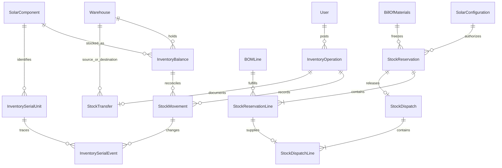
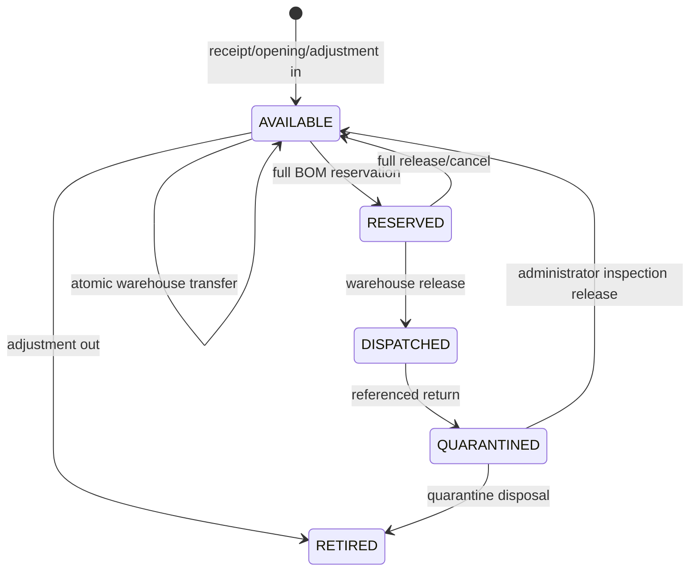

# M04 inventory and warehouse technical documentation

M04 reuses the M03 SolarComponent master catalog and exact approved configuration/BOM. No frontend code, installation milestones, warranty activation, procurement, vendor invoices, costing engine or later-module backend is implemented. Main baseline is bcaae2a (M03 PR #3 merged); M01 d48b434, M02 136e62b and M03 0c8ee52 are ancestors of that baseline.

## Model relationships

Eleven new models: Warehouse, InventoryOperation, InventoryBalance, StockMovement, InventorySerialUnit, InventorySerialEvent, StockReservation, StockReservationLine, StockDispatch, StockDispatchLine and StockTransfer. Three enums: StockMovementType, InventorySerialState, StockReservationStatus. Existing models gain inverse relations only. Existing M01–M03 migrations are unchanged. Migration `20261031000400_m04_inventory_warehouse` is additive, enclosed in BEGIN/COMMIT and NOT APPLIED.

Warehouse has immutable unique code, contact/address fields, active flag and optimistic version. No warehouse/storage-area hierarchy is invented. Deactivation is refused while usable/reserved/quarantined stock or active reservations remain. Dispatched serials retain the last warehouse of release, even after physical exit; they do not count as warehouse on-hand obligations.

## Quantity semantics and movements

All stock quantities use Decimal(18,3); public mutation amounts are decimal strings up to 12 integer/3 fractional digits. PCS/SET/PAIR and serialized equipment require whole quantities. Serialized equipment must use PCS. Counts are never rounded silently. No client may set physical balances or available amounts.

- On-hand = usable physical stock, including reserved usable stock.
- Reserved = usable stock assigned to active project reservations.
- Available = on-hand − reserved.
- Quarantined = separate physical stock awaiting inspection, excluded from on-hand and available.
- Total physically present = on-hand + quarantined.
- Shortage = max(required − available, 0).
- Low stock = available <= reorder level, including zero availability at a zero threshold.

A balance exists only after initialization through a stock/reorder operation. A component with no balance is treated as zero for BOM availability; it does not appear in low-stock monitoring until a balance/reorder policy is initialized. Summary quantities are grouped by unit so meters are never summed into equipment counts. Summary reports quantity aggregates, active warehouse/reservation counts and low-stock balance counts; it does not claim financial valuation. M03 prices are estimates, not acquisition-cost layers.

| Movement | On-hand delta | Reserved delta | Quarantine delta |
|---|---:|---:|---:|
| OPENING_BALANCE / RECEIPT / ADJUSTMENT_IN | +q | 0 | 0 |
| ADJUSTMENT_OUT / TRANSFER_OUT | −q | 0 | 0 |
| TRANSFER_IN | +q | 0 | 0 |
| RESERVATION | 0 | +q | 0 |
| RESERVATION_RELEASE | 0 | −q | 0 |
| DISPATCH | −q | −q | 0 |
| RETURN | 0 | 0 | +q |
| INSPECTION_RELEASE | +q | 0 | −q |
| QUARANTINE_DISPOSAL | 0 | 0 | −q |

Each movement stores balance/component/warehouse through a noneditable balance FK, operation/reference/actor/reason through an immutable operation FK, positive quantity, type, timestamp, reservation/dispatch line links and before/after quantities. Reservation events are not physical transfers. Corrections create compensating operations. Opening balances are restricted to the first movement for that warehouse/component. Receipts and adjustments post immediately; there are no draft receipt states. Receipt date/supplier notes are preserved in InventoryOperation.payload; serialized receipt dates are also first-class fields.

## Atomicity, idempotency and races

Every write creates or replays an InventoryOperation inside the existing Serializable transaction helper. Its global idempotencyKey and (kind,reference) are unique. SHA-256 covers the operation kind and canonical parsed input, including target IDs and expected versions. Identical key/body/actor returns the original frozen result; a reused key for another body/actor is 409. New keys with an already-posted kind/reference conflict. References must therefore be globally unique within each kind, including warehouse updates. Do not recycle keys after retention; operations are retained indefinitely. Current authorization is checked before replay. Replays return posting-time results, not live balances.

Balance rows are initialized at zero, locked with SELECT FOR UPDATE and changed exclusively by the StockMovement insertion trigger. The trigger validates prior snapshots, applies the exact type delta and increments the balance version. Constraints reject negative usable/quarantine/reserved stock or reserved > on-hand. Serialization failures/deadlocks surface through Prisma P2034 as 409 CONCURRENT_UPDATE; unique races surface as 409 DUPLICATE_VALUE. Clients re-read and retry the same request/key when its outcome is uncertain; deliberate changed requests require new keys. There is no hidden automatic retry.

Reservations process component IDs in sorted order; transfers lock warehouse balances in sorted warehouse order. Serializable predicate reads protect warehouse deactivation, eligibility, serialization-policy changes and the one-project-allocation rule. Some conflicts may still roll back; that is expected. Existing transaction timeout/maxWait remain unchanged; large serial batches may time out and need smaller receipts. A full serialized BOM must fit the bounded request; unsupported large projects need a separately designed batching workflow.

PostgreSQL guards enforce immutable movements/events/transfers/dispatches/reservation lines, one finalization of operation results, catalog serialization-policy freeze after inventory initialization, exact movement deltas, whole counts, immutable identities, legal serial/reservation transitions, immutable dispatch quantities and monotonic bounded returned quantities. Deferred guards reconcile active reservation totals with reserved balances and serial counts with usable/reserved/quarantine stock, and require serial audit events. These are defense in depth for supported service writes, not a claim that arbitrary database superuser activity is safe. Production DB privileges should restrict application users from disabling triggers or bypassing services. SQL/PLpgSQL has been reviewed as text, not executed.

The choices follow [Prisma 6 transaction guidance](https://docs.prisma.io/docs/orm/v6/prisma-client/queries/transactions), [PostgreSQL Serializable semantics](https://www.postgresql.org/docs/current/transaction-iso.html) and [constraint-trigger behavior](https://www.postgresql.org/docs/current/sql-createtrigger.html). Static checks do not establish these runtime guarantees for this migration.

## BOM allocation and lifecycle

M02 exports an internal eligibility guard after caller scope checking; its existing HTTP behavior is preserved. M03 similarly exports approvedConfigurationRecord(tx,configuration). M04 checks inventory RBAC/project scope first, then calls the shared M03 guard in its own transaction. The guard validates approval/version/review, current eligible approved survey/customer/lead, and no successor configuration or survey. Inventory cannot expose draft/rejected/superseded BOM availability or reserve it. No fabricated ADMIN principal or broadened M03 HTTP permissions is used.

Availability is a single-warehouse read, not a promise or allocation. Inactive catalog components are unavailable even if physically stocked. Response statuses are AVAILABLE, PARTIAL or UNAVAILABLE with explicit per-line shortage quantities. A valid existing full reservation may make raw availability zero; use reservation availability to distinguish stock reserved for that project.

Full reservations only: all BOM lines/quantities must be fulfilled from one warehouse, including exact serial selections where required. Any shortage rolls back every line. No partial/cross-warehouse reservation, quantity substitution or over-reservation is supported. The service permits at most one ACTIVE or DISPATCHED reservation for the same lead/site across configuration revisions/proposals; PostgreSQL also has a partial unique index for the exact configuration. A full release/cancel makes a new reservation possible. A dispatched project cannot be silently reserved again, even after returns; replacement shipments are outside this version.

Reservation states: ACTIVE → RELEASED, CANCELLED or DISPATCHED. Terminal states never reactivate. Release/cancel uses exact version and remains possible for obsolete approvals or inactive components to clear obligations. Dispatch rechecks the current exact approval/BOM identity and active warehouse/catalog; stale work must be released and re-reserved after review. One full posted dispatch per reservation; no partial dispatch. Dispatch timestamp must be between reservation creation and now. Warehouse release does not mean delivery, installed equipment or installation completion.

## Serial lifecycle and returns

Global serial numbers are trimmed/uppercased and unique for all time, even after retirement. Receipts supply exactly one unique serial per serialized unit; unsolicited serials for nonserialized parts are rejected. M03 serialization policy is frozen once any inventory balance exists for that component. This avoids reinterpreting historical stock; use a new SKU for a different tracking policy.

Transfers move only available stock and serials; two ledger legs and serial warehouse changes commit together. Returned quantity cannot exceed dispatched minus cumulative returned quantity. Serialized returns must select DISPATCHED serials belonging to that exact dispatch line; they may arrive at another active warehouse. All returns, including nonserialized material, enter quarantine. Inspection release/disposal requires ADMIN, a reason/reference and selected serial IDs when applicable. Nonserialized quarantine inspection consumes the component/warehouse quarantine pool; it is not a lot-quality system.

Live serial reservation/dispatch pointers describe current state. Immutable serial events and reservation/dispatch serialUnitIds arrays preserve earlier allocation identities across returns, releases and redispatches. Dispatch detail resolves those historical IDs, so later lifecycle changes do not remove traceability. Warranty activation, installation, damaged-item repair and certification are not performed.

## Access and handoffs

ADMIN manages warehouses/reorder policies and controlled adjustments, and has operator/oversight access. WAREHOUSE performs receipts, transfers, reservations, releases/cancels, dispatch and returns. FINANCE has oversight reads including ledger/operation references, with no invented acquisition valuation. SALES receives only scoped project availability/reservation/dispatch reads using the M01 lead scope. TECHNICIAN receives only scoped project reads where currently assigned to the underlying survey. SUPPORT has no M04 access in this version. No global balances, serial search or operation payloads are exposed to SALES/TECHNICIAN.

M05 handoff is GET /api/inventory/dispatches/:id: POSTED warehouse release, immutable reference/date, original configuration approval/review/BOM identities, customer/lead/site/survey identity, component/BOM-line IDs, units/quantities, original serial IDs and their current trace. Reservation detail includes status/version and committed line identities. Future M05 must establish its own authorization and installation lifecycle; it must not infer completion here.

M07 handoff uses dispatch historical serial IDs plus GET /serials/:id and paged /serials/:id/history for authorized inventory readers. The serial record includes original receipt operation/date, component ID, immutable serial number, current warehouse/state and event history. No warranty dates/registrations or activation are created. New later-module roles/consumers must deliberately use shared authorization rather than exposing global serial history to all technicians.

See the exact API contract, code explanation, evaluator QA and M04_VERIFICATION.md for routes, bounded inputs and remaining runtime verification.
