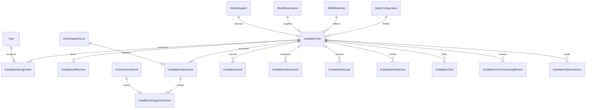
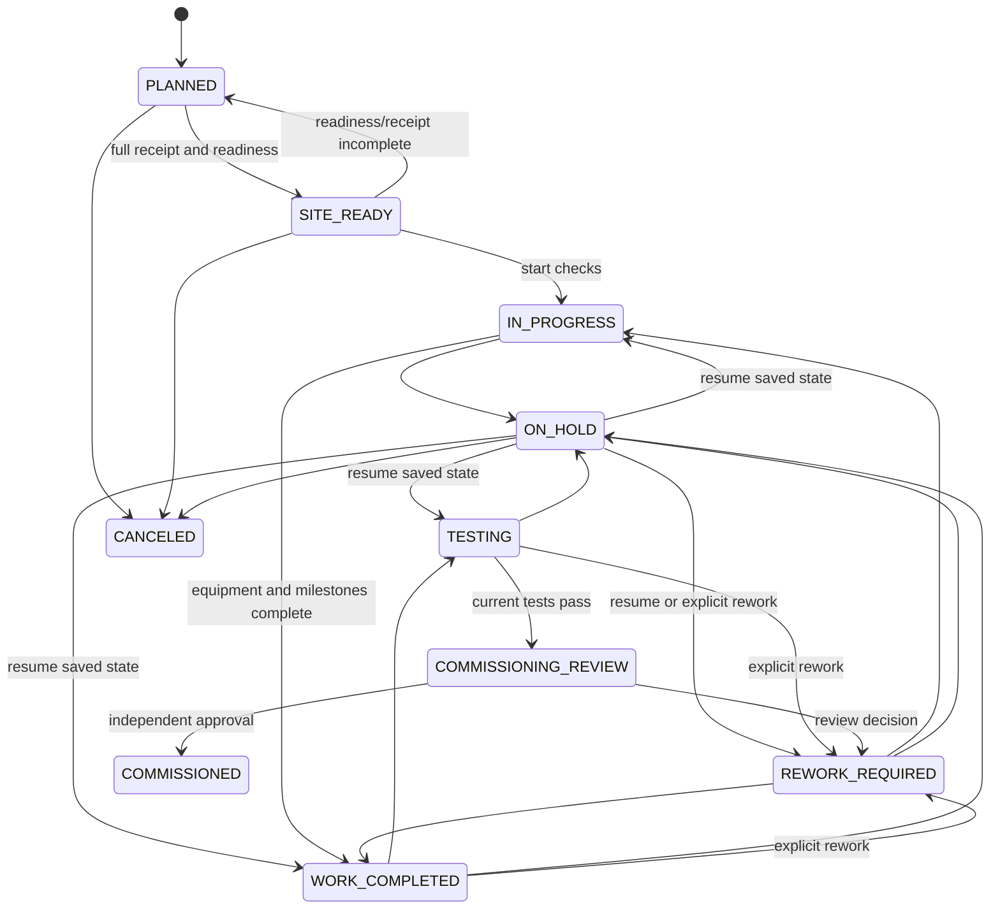

# M05 installation technical documentation

M05 depends on M04. M04 PR #4 merged at 2a6a441daff417bc96d50323e9a710b88a71627f before this branch was created, so M05 starts from origin/main and its PR targets main. Existing frontend modules are preserved; no M06–M10 backend is implemented.

## Workflow and responsibilities

M03 approves the design/BOM; M04 releases the exact equipment from a warehouse. ADMIN creates a PLANNED installation using the same configuration approval/version/review, BOM/version, reservation and posted dispatch. Identity is derived from those existing records; no duplicate catalog/customer/site/project/inventory master is introduced. A job and its equipment must account for every BOM/dispatch line. Returned dispatches cannot initialize jobs. There is at most one noncanceled job per lead/site and one job per dispatch/reservation for all time. Cancellation does not silently enable reuse of the same shipment or serial identities.

Site receipt is a separate evidenced M05 observation, not inferred from warehouse release. It records actor, site receipt date, notes, cumulative usable/damaged quantities, exact received/damaged serial identities and immutable receipt history. Missing/damaged quantities create HIGH blocking issues that must be explicitly resolved. Partial verification is allowed before execution, but every dispatched unit must be verified usable before start. Inventory stock is not changed by receipt verification.

Readiness records site access, accessible area, roof/site observation, safety measures, reviewed survey limitations and addressed conditional work. All checks must pass, outstandingIssues must be null, and evidence/conditional-work rationale must be present. This is an internal attestation; it is not structural/electrical certification. No automatic declaration resolves survey limitations. Actors must record how applicable conditions were addressed.

## ER diagram

Twelve new models and eight enums. Existing records gain inverse relations only. Composite ownership FKs tie site/customer and milestone/issue/equipment attachments to the same job. Equipment retains the exact dispatch line/component/unit/quantity and original serial IDs through normalized unique serial claims. Decimal(18,3) quantities are nonnegative, counted units whole, and installed <= usable received <= dispatched minus damage/returns. Measurements use Decimal(24,6), paired with units; no threshold or measured value is invented.

## State machine

Resume uses the stored prior status, not a client-selected arbitrary state. Readiness/eligibility is checked again. Cancel requires ADMIN and zero installed equipment; otherwise corrective removal is required and is not implemented. Commissioned/canceled jobs are terminal and all child writes freeze. Commissioning submission freezes edits until independent review. No rejection decision or silent reopening is supported; REWORK_REQUIRED is the explicit negative decision. To amend completed/testing work before submission, request rework and perform execution again. Commissioned corrections/superseding jobs, substitutions, replacement dispatches and removal workflows are outside M05 and must not be faked through status PATCH.

## Execution, tests and review

Ten milestone definitions are created for each real job, not seeded as sample data. Battery is required only when the approved BOM includes batteries; mounting is required only with mounting material. Other core milestones are required. Optional nonapplicable milestones may be marked NOT_APPLICABLE only by ADMIN. Plans expose dates and responsible active assigned users; generic checks are approved-design-followed, safety-checked and evidence-reviewed. Completion requires all checks, responsibility, notes, evidence and no blocking/high/critical issues. Planning does not claim workforce capacity, conflicts, availability or M06 scheduling.

Equipment installation records cumulative nondecreasing quantity, observed location, server timestamp, installer and notes/evidence history. Serialized installation names the exact cumulative verified usable serial set. A serial is globally claimed by one installation for all time in this version; installed identities/placements are immutable. No unrecorded substitution, uninstall or reuse is allowed. M05 adds protective triggers to current M04 dispatch-return counters/serial state so returns cannot orphan installed records; it never rewrites M04 historical movements/dispatches.

The job has a version and a separate executionRevision. Every mutation uses expected job version and records actor/from/to/reason/details/version atomically. Readiness, receipt, equipment, milestone, issue and job-content changes increment executionRevision. Tests carry that revision; all prior test results become stale after such a change. Attachments and assignment changes increment public version but do not by themselves invalidate physical test results. Explicit rework increments executionRevision. Test history is append-only; commissioning considers the latest record per type in the current execution revision.

ADMIN supplies all nine test definitions and a real design/manufacturer basis before start. Core tests cannot be disabled; battery is not required without batteries, mounting verification depends on mounting material. Requirements specify whether an actual measured value/unit is mandatory. Record input must cite the exact stored basis; the backend does not infer a universal electrical threshold or evaluate whether an observed electrical value is safe. An authorized tester attests PASS/FAIL/NEEDS_REVIEW with observations/evidence. Optional N/A requires ADMIN, rationale, no measurement and NEEDS_REVIEW (never fabricated PASS). Applicable latest FAIL/NEEDS_REVIEW blocks commissioning even for optional tests. Required tests must have current PASS records.

Commissioning additionally requires current eligible M03/M04 identity, full site receipt/readiness, all required milestones, all equipment installed, no blocking/high/critical issues, work start/end/completion notes and a COMPLETION evidence object. An active independent ADMIN who neither created nor changed the job must review the exact submitted public version. Earlier review-only activity does not disqualify a reviewer on a later submission. Immutable review snapshot includes equipment/serials, tests, milestones, readiness/receipts, issues and safe evidence metadata. Every approval checklist item must be true. Approval records commissionedAt separately from deliveryConfirmedAt and actualWorkEndAt.

## Transactions and database constraints

Existing Serializable transaction helper is reused. Expected-version updateMany must affect one job; all related records/history roll back on failure. Stock/installation race checks read actual current dispatch and serial state in the same transaction. SQL equipment guards lock dispatch lines; child guards lock the job; serialized count reconciliation is deferred until commit. Conflicts may surface as 409 CONCURRENT_UPDATE/VERSION_CONFLICT; no automatic retry or overwrite is performed. These strategies follow [Prisma 6 transactions](https://docs.prisma.io/docs/orm/v6/prisma-client/queries/transactions) and [PostgreSQL constraint triggers](https://www.postgresql.org/docs/current/sql-createtrigger.html). They remain runtime-unverified here.

Unique dispatch/reservation/equipment/serial claims make duplicate creation conflict safely. Other writes are versioned commands, not idempotency-key APIs: after an uncertain response re-read job/history before deliberately retrying. There are no inventory side effects in M05. Existing 5-second transaction timeout/maxWait are unchanged; larger shipments/snapshots may require future batching rather than silently increasing global limits.

Additive migration 20261031000500_m05_installation_management contains FK/index/quantity/state guards, immutable audit/evidence/review tables, terminal child freezing, exact dispatch ownership, monotonic installed quantities and deferred serial counts. Commissioned state requires persisted independent review and resolved completion/test prerequisites. M01–M04 migrations are unchanged. Custom PL/pgSQL is reviewed as text, not executed or validated by Prisma schema parsing. Restricted DB privileges remain necessary; arbitrary database-owner edits/disabling triggers are outside service guarantees.

## Private evidence and access

Reuses the existing LocalSurveyStorage interface/secure path, exclusive-create, no-follow-read and digest checks with a separate installation directory. Default ~/.solar-installation/installation-uploads, configurable INSTALLATION_STORAGE_DIR outside repository/public/build, default max5MiB, supported max10MiB. Raw JPEG/PNG/PDF only, filename/MIME/signature agreement, 50 objects/job, 10 uploads/15min, Origin/cookie/CSRF checks before binary body consumption. Protected downloads force attachment + sandbox policy. Metadata exposes digest/size/actor/time, never storageKey/path. File signatures are not malware scanning; production needs private-volume ACLs, scanning/reconciliation/retention/backups. No storage directory/file is created during static verification.

ADMIN coordinates/edits and independently reviews; assigned TECHNICIAN edits only that job. SALES reads only M01 lead-scoped progress/evidence. WAREHOUSE has a limited equipment-reference endpoint, not job notes/evidence. FINANCE reads commissioned job/completion summaries only and cannot download private files. SUPPORT has no broad M05 permission in this version. There is no INSTALLATION_MANAGER backend role; ADMIN is the explicit mapping. Assignment does not implement M06 scheduling.

## Future handoff and limits

GET /:id/commissioned returns the immutable approved completion identity, configuration/BOM approval, dispatch reference, delivery and commissioning timestamps, installed quantities/serial IDs, latest test summary, outstanding nonblocking issues and completion evidence metadata. Historical commissioning remains readable if a later design supersedes the original; approval is checked at commissioning time, not silently revoked afterward. No warranty start date is assumed: warrantyStartDate is NOT_DETERMINED_BY_M05, externalGridAuthorization is NOT_RECORDED. Internal commissioning is not utility permission to energize, customer delivery confirmation of the whole project, or regulatory certification.

M07/M08 must deliberately authorize their future consumers and use this handoff; no warranty/service ticket/billing/ workforce logic is implemented. Current strict full-BOM installation excludes spare/unconsumed material allocation, replacement shipments, partial commissioning, cancellation after installation, removal and postcommission corrections. Existing frontend mocks require an explicit adapter. Static generation/validation/typecheck/build are not evidence of runtime safety or end-to-end readiness.
