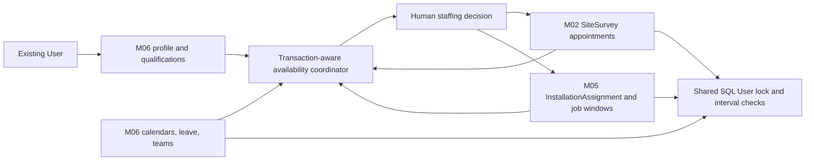
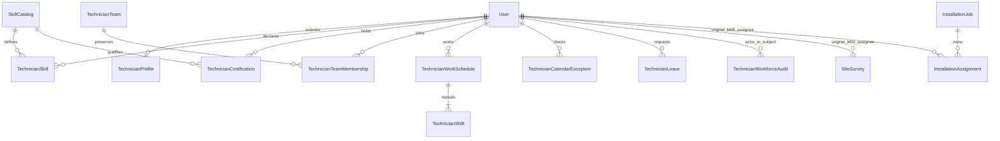

# M06 technician workforce technical documentation

M05 PR #5 merged at 03aa1244262fabfad14f290c788421b7f078558f before M06 branched from origin/main. M06 depends on the actual M01–M05 schema/services and targets main. No frontend or M07–M10 backend is implemented.

## Ownership and architecture

User remains the only authentication identity. TechnicianProfile extends an existing TECHNICIAN User one-to-one; M06 does not provision passwords/accounts, change roles or create a separate technician login. Existing trusted operator scripts remain the provisioning path. M02 owns actual SiteSurvey assignment/scheduling/visit/status history. M05 owns InstallationAssignment authorization and InstallationJob plans/execution/commissioning. No WorkforceBooking/master assignment table is added: the coordinator reads those authoritative records directly.

Eleven models, four enums. Profile has immutable employee code, private contact/emergency details, base location, employment status/joined date, experience/specializations, maxActiveAssignments, minimumRestMinutes, scheduling enforcement flag, active status and version. Profile mutations after creation, skill changes, certification creation and schedule/exception creation use the expected profile version. Certification review/exception cancellation, leave actions, catalog and team actions use their own entity version. Audit captures actor/time/action/subject/entity/reason and sanitized operational details; it does not duplicate emergency contacts, certificate numbers or leave private notes.

## Scheduling policy and adoption

Intervals are UTC half-open [start,end). Adjacent jobs are allowed only when configured minimum rest permits it. Known M02 committed intervals are SCHEDULED/IN_PROGRESS scheduledAt–scheduledEndAt; no duration is invented for REQUESTED/untimed revisions. M05 lacks per-technician timed sessions, so every assigned technician is conservatively occupied for the whole job plannedStartAt–plannedEndAt span until the job is COMMISSIONED/CANCELED. This is a planning hold, not worked hours, attendance, an all-day estimate for an untimed survey or a claim of physical work at night.

Profiles default enforceScheduling=false for explicit legacy adoption. All new known-interval assignments, including legacy/unprofiled users, still reject inactive User/profile, cross-module work overlap/rest, approved leave and calendar blocks. Managed profiles additionally require known working-calendar coverage, required verified qualifications/certification validity, capacity and no untimed/overdue uncertainty. A missing profile/calendar or qualification policy never produces a positive committable recommendation. Legacy M02/M05 endpoints remain usable without inventing profile/qualification data; public M06 responses expose managed=false and committable=false. Operational rollout must explicitly configure and enable managed profiles.

Recommended setup order: provision existing User through trusted scripts, create profile in monitor mode, configure actual skill requirements/catalog and verified evidence, define effective calendar/shifts, resolve old conflicting/untimed commitments, then enable enforcement. Profile/qualification/calendar edits revalidate up to 100 upcoming commitments per source inside the same transaction and reject unsafe changes. Catalog mandatory policy cannot be changed while any profile is managed; explicitly resolve/disable managed enforcement before changing/reviewing policy. No silent reassignments or mass invalidation is performed. Re-enabling managed mode revalidates commitments. This is conservative and may require planned administrative coordination; it is not a policy rollout engine.

maxActiveAssignments is a count ceiling across active M02 requests/schedules/visits/submissions/revisions and nonterminal M05 assignments, excluding the proposed current source. It is not an hourly utilization figure. minimumRestMinutes is an explicit operator setting, not an asserted legal rest standard. Team membership is one active team per technician. Team membership alone does not reserve everyone for a teammate's work; only individual authoritative assignments create obligations. Team removal retains membership history and never removes M05 authorization. Clear lead/memberships before deactivating a team; clear assignments/membership before deactivating a profile/User.

## Working calendars and time zones

Schedules have explicit IANA timezone, effective UTC bounds, weekly weekday shifts (Sunday0–Saturday6), start/end minute0–1440 and optional within-shift break bounds. Effective schedules cannot overlap while active; weekly shifts cannot overlap. Replace by archiving the old header and creating a new header/immutable shift rows; history stays present. Overnight work must be represented with separate weekday segments. Holidays, nonworking days and admin blocking periods use explicit UTC calendar exceptions; no national holiday feed is fabricated.

calendar.ts converts each local weekly boundary to candidate UTC instants from surrounding timezone offsets and round-trips Intl local parts. A boundary resolving to zero or multiple instants is uncertain, not silently shifted through a DST gap/fold. No available result is asserted for ambiguous boundaries or effective-date gaps. Coverage clips valid shifts/breaks to schedule and requested bounds, unions intervals and subtracts known occupied/leave/block/rest intervals. Offset/formatter behavior depends on Node's ICU timezone data and needs runtime boundary verification; the implementation deliberately fails closed rather than claiming a complete temporal scheduling library.

Availability queries are max7 days, batches max30 technicians, paged computed lists max20. Managed source commits longer than7 days require an explicit future workflow; legacy known-interval checks support up to366 days. Large/history-heavy cases return DATA_LIMIT/UNKNOWN or a revalidation conflict, not fabricated completeness. Existing Prisma transaction timeout remains5s; no production throughput guarantee is made.

## Availability algorithm

1. Establish ADMIN/own scope, or SALES ownership of the supplied M02 survey context. Read actual TECHNICIAN User/profile; inactive identity/profile → INACTIVE.
2. Read effective calendars/shifts, active team reference and canonical M02/M05 commitments. Read approved leave and active blocks. No medical/private notes are included in availability.
3. Expand committed interval boundaries by configured rest. Detect unknown unscheduled requests and overdue ongoing work without extending them to an invented end time.
4. Union working coverage and subtract actual blocking intervals. Report actual free intervals and shift/available/planned-occupied-shift minutes in comparable units.
5. For each requested purpose, require an active mandatory skill policy. Required skill level must be VERIFIED. If certification is mandatory, a VERIFIED certificate must cover the complete requested period (issuedAt<=start, expiresAt>=end). Unverified/rejected/expired evidence never qualifies. Stored skills are not electrical licensing or regulatory permission.
6. Return AVAILABLE/PARTIALLY_AVAILABLE/BUSY/ON_LEAVE/OFF_SHIFT/INACTIVE/UNKNOWN/NEEDS_REVIEW and explicit reason codes. Definite full-window approved leave is ON_LEAVE even with incomplete calendar; other uncertain profile/calendar/timing/data → UNKNOWN; qualification gaps → NEEDS_REVIEW. AVAILABLE requires full free shift coverage. Partial status is supported by explicit free intervals, not a guessed duration.
7. Survey committable requires managed profile, no blocking/uncertainty/qualification/capacity reason and full window coverage. Coarse installation planning may accept partial shift coverage only when the whole planning span is known, there is some working coverage and there are no source/leave/rest/qualification/capacity blockers. It still holds the entire planning span against other assignments. This does not enforce clock-in/attendance or authorize actual off-shift work; per-technician installation sessions are not implemented.

Requirements purposes: SURVEY, PV_INSTALLATION, INVERTER, BATTERY, COMMISSIONING. M05 staffing derives PV_INSTALLATION/COMMISSIONING plus inverter/battery purposes from the actual approved BOM. Every requested purpose needs a configured mandatory policy before managed recommendations can pass. Self-declared skills and certificates remain DECLARED; only ADMIN verifies using an opaque evidence reference from an authorized document system. M06 does not upload/publicly expose HR certificate files or fetch arbitrary URLs. Certification expiry is evaluated on each query; stale status text does not imply validity.

Recommendations are human decision support: eligible first, then fewer active assignments, more actual profile experience and stable user UUID. Ordering is deterministic **within the selected page**, not a global optimizer. Team filter uses actual active membership. No travel-time prediction, geocoded-distance inference or automatic assignment is claimed.

## Leave, concurrency and integration

REQUESTED → APPROVED/REJECTED/CANCELLED; APPROVED → CANCELLED only before start. No edits silently rewrite dates/category/private notes. Pending/approved overlapping leave is rejected. ADMIN approval and active calendar blocks must not overlap any committed M02/M05 window; reschedule/reassign in the owning module first. Personal/medical/emergency/unavailable categories are private ADMIN/own records; public availability shows only generic blocking reason codes.

M02 scheduling/reassignment of scheduled appointments and starting visits call assertStaffing(tx,...) in the original survey transaction. Original M02 status/visit/evidence/independent approval/security rules and source history remain in place. Existing M02 availability fields remain; available now includes workforce status, with an additive workforceStatus. Windows longer than7 days return workforce NEEDS_REVIEW/available=false instead of pretending the partial engine is complete.

M05 creation, technician assignment and planned-window changes call the same coordinator in the original installation transaction. The actual InstallationAssignment table is retained; team actions never delete its rows. Existing M05 role/milestone/evidence/commissioning/terminal rules remain. New staffing conflicts may return409; no extra M02/M05 request field or separate assignment master is introduced. Positive explicit installation planning intervals are required; formerly accepted zero-width plans cannot establish workforce availability.

SQL locks the existing User row as a shared contention point across source writes and workforce changes. m06_assert_interval checks known cross-table appointments/jobs, rest, leave/blocks and managed count capacity. Source triggers protect new/changed survey windows, installation assignment inserts and job-window edits. Leave/exception approval triggers check source commitments under the same User lock. Serializable transactions protect predicate reads and concurrent policy changes; M02's prior survey exclusion remains intact. GiST exclusion constraints add nonoverlap for effective schedules, weekly shifts, membership history and pending/approved leave/active blocks. Source appointment/job rows remain authoritative, so no booking projection becomes stale.

M05 user loops are sorted; source job locks may still interact with workforce User locks and cause deadlocks/serialization failures. Clients must refresh/retry deliberately; no automatic reassignment/retry or deadlock-free claim. Application-side calendar/DST/qualification checks and DB known-interval guards complement each other; direct privileged SQL is not a substitute for the service policy. Full race/rollback behavior and custom PL/pgSQL are static-reviewed only, not executed.

## Privacy, metrics and limits

ADMIN configures workforce and sees authorized private records. TECHNICIAN sees only own profile/emergency contact (private ADMIN notes omitted), qualifications/schedules/leaves/workload/assigned source references; self skill/certificate updates cannot verify or modify existing verified skills. SALES sees limited availability only with an authorized survey and no unrelated work IDs/references, certificate numbers, employment contacts or leave category/notes. SUPPORT has no M06 workflow yet, so no broad access; WAREHOUSE/FINANCE have none. No password/session hash is selected. Audit details intentionally avoid copying sensitive values; reasons should contain operational rationale, not clinical histories. HR/evidence retention and privacy-rights handling need an explicit operator policy; no public employee archive/delete API is introduced.

Dashboard counts, skill coverage, expired certificates, assignments and final-assignee completion proxies query PostgreSQL. plannedSurveyMinutes comes from real scheduled bounds. Installation planning spans are not counted as worked hours. Available shift minutes and planned occupied shift minutes share the same interval units; utilizationPercent/actualWorkedHours remain null because actual labor/attendance is absent. Final-assignee completed counts are not proof of individual labor/productivity. Conflict reports include existing work overlap/rest pairs, work-versus-leave/block pairs and eligibility warnings, with incomplete-data markers.

Eleven-model additive migration 20261031000600_m06_technician_management is NOT APPLIED. Earlier migrations unchanged; btree_gist comes from M02. No sample technicians/skills/holidays/teams or assignments are seeded, no server/tests/database changes are executed. Existing React in-memory mocks need the explicit API adapter. Stop after M06.
