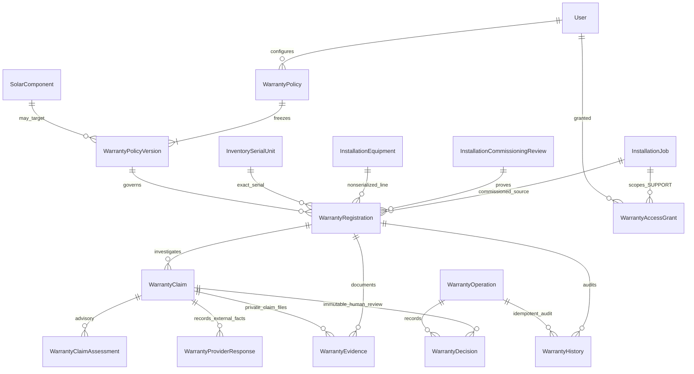
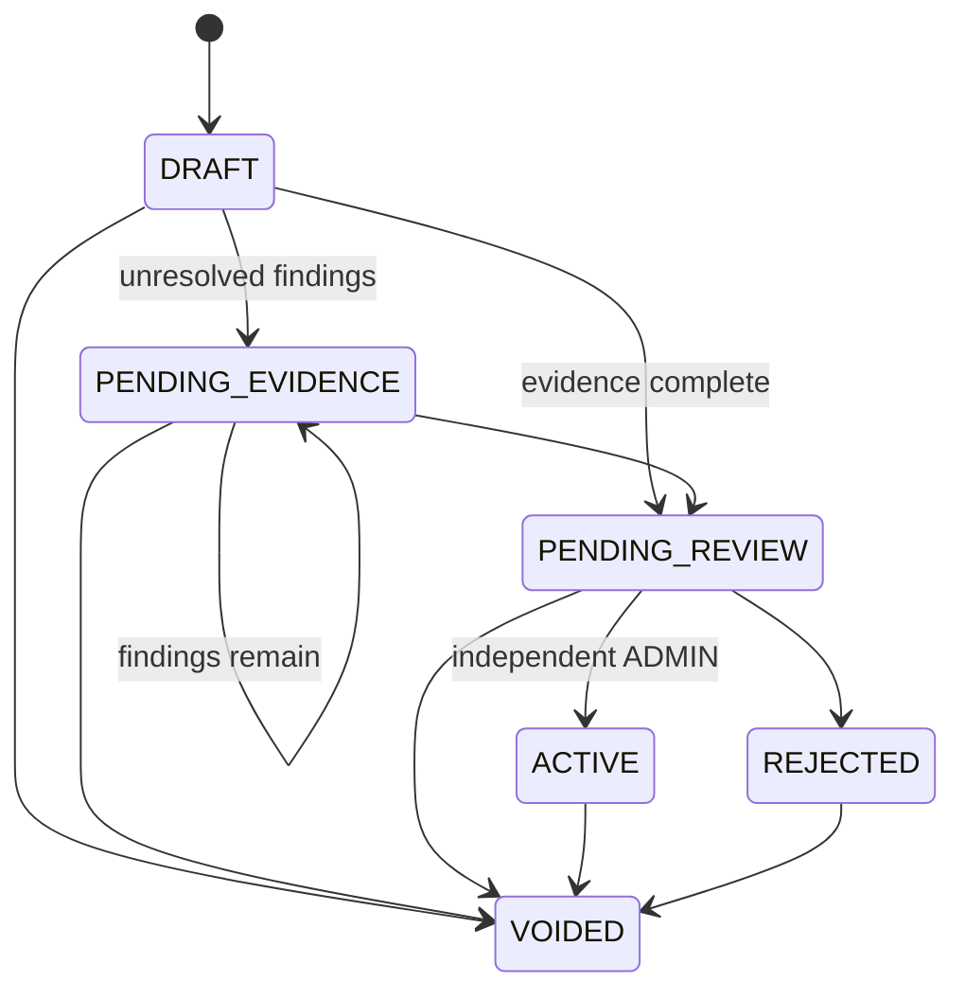
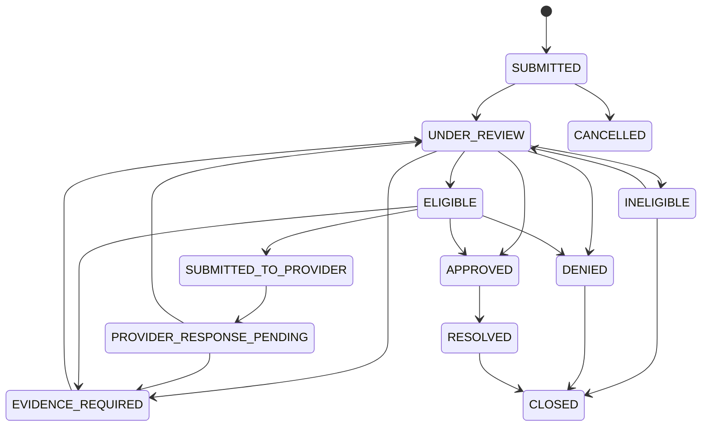

# M07 warranty technical documentation

M06 PR #6 was open at inspection. M07 therefore starts from origin/codex/m06-technician-management head fce98e7091dbd2ef0d8b6ff79d63794b6df0cebc and is a stacked PR targeting that branch, not main. Main at inspection is 03aa124. Retarget to main only after M06 merges and a fresh comparison confirms M07-only changes. Preserve all original M01–M06 commits/migrations and frontend work. No M08–M10 backend is implemented.

## Architecture and identity

M07 is a warranty register/case workflow, not a legal coverage oracle, stock allocator, service scheduler or financial reimbursement system. M03 remains component/BOM owner; M04 remains original inventory/dispatch/serial owner; M05 remains commissioned installation/equipment owner; M06 remains workforce/identity metadata owner. M07 does not change stock movements, installed equipment, commissioning or technician assignments.

Eleven models: WarrantyPolicy, WarrantyPolicyVersion, WarrantyAccessGrant, WarrantyOperation, WarrantyRegistration, WarrantyClaim, WarrantyEvidence, WarrantyClaimAssessment, WarrantyProviderResponse, WarrantyHistory, WarrantyDecision. Eight enums cover coverage/provider/duration/start-rule/registration/claim/document/assessment types. Composite FKs tie evidence/history/decisions to the claim's exact registration and equipment to the same installation/site/customer. Restrictive deletion and unique identifiers retain provenance.

M05's commissioned(user,id) now delegates, after its unchanged scope check, to commissionedRecord(tx,row). M07 establishes its own scope before invoking that read-only guard in the same transaction. The original M05 endpoint shape/permissions are preserved. Only commissioned jobs with the matching immutable APPROVED commissioning review and installed equipment qualify. Serialized coverage must name the exact original installed M04 serial through InstallationEquipmentSerial; nonserialized coverage uses the entire installed equipment-line quantity, with no fabricated serial or partial split. Workmanship is separate project/site coverage with no equipment/serial and quantity1. It is not assumed to cover equipment failure.

## Policy versions and dates

ADMIN explicitly configures real terms; no policy/duration/manufacturer promise is seeded or inferred from M03 warrantyMonths. Coverage kinds are MANUFACTURER_PRODUCT, MANUFACTURER_PERFORMANCE, INSTALLER_WORKMANSHIP and EXTENDED_COVERAGE. Product and performance are distinct policy references, so a panel may have both. Workmanship requires INSTALLER provider/project scope; equipment policies target exactly one component or category. Different coverage/provider kind needs a new policy reference, not silent mutation.

Policy headers have immutable reference, display name, active state/current revision and optimistic header version. New terms create immutable sequential WarrantyPolicyVersion rows. Registration freezes that version plus reference/name and the commissioned handoff. Rename/deactivation/version publication cannot silently change active coverage. New registration/activation requires current active policy. Superseded pending registrations must be explicitly voided/re-created against the new version; active historical registrations continue under their original terms. Policy deactivation does not bulk-void coverage.

Effective dates are start-inclusive/end-exclusive. ADMIN retrospective effectiveFrom needs a separate backdatingReason; no other role publishes policies/backdates terms. Supported numeric duration limits (36600days/1200months/100years) bound arithmetic, not recommended warranties. Explicit registrationDeadlineDays may apply: when provider registration is required, compare actual providerRegisteredAt against start+deadline; otherwise compare the internal registration's created civil date. A missed deadline blocks activation; there is no hidden waiver.

Calendar convention is **UTC civil dates**, midnight dates, not 24-hour timestamp durations: [start,expiry). DAYS adds calendar days. MONTHS adds months and clamps to the last valid day; YEARS adds12months per year, so 2024-02-29 +1year expires2025-02-28, exclusively. Original rule, source dates, policy version and review snapshot remain. This convention is explicit and may not express every manufacturer's local-time/inclusive-end legal terms; operators must configure/verify suitable real terms and use MANUAL_VERIFIED_DATE when an external verified civil date is required. The system is not a legal interpretation engine.

Start rules:
- COMMISSIONING_DATE uses M05 commissionedAt UTC civil date only because the policy explicitly selects that rule.
- INSTALLATION_COMPLETION_DATE uses M05 actualWorkEndAt UTC civil date, not commissioning/delivery by default.
- DELIVERY_DATE requires an observed proposedStartDate, external DELIVERY_PROOF and source notes. M04 dispatch and M05 site receipt are never treated as customer delivery.
- PURCHASE_DATE requires observed date/PURCHASE_PROOF/source notes; no purchase invoice/payment is invented.
- MANUFACTURER_REGISTRATION_DATE requires actual provider reference/date and MANUFACTURER_REGISTRATION confirmation/source notes.
- MANUAL_VERIFIED_DATE requires observed date, OTHER evidence/source notes and independent ADMIN verification.

Required configured documents are checked by category. Files/checkboxes do not mechanically prove authenticity/legal entitlement; the reviewer must inspect them. Unknown source dates/documents retain pending evidence with explicit activation findings. Candidate dates/expiry are displayed during submission; verified coverage dates are stored only on approval. Future observed dates and out-of-effective-range starts block activation.

## Registration lifecycle and duplicates

Evidence date/reference editing is limited to DRAFT/PENDING_EVIDENCE. Submission freezes those fields for review. Independent ADMIN who neither registered nor changed the registration verifies all checks and persists an immutable decision snapshot. ACTIVE dates/source/policy identity/approval never change; additive later certificates may increment public version/history without rewriting original approval. Void is an explicit ADMIN decision/reason preserving original dates/claims. Rejected/voided registrations remain historical.

Canonical coverageKey combines policy ID, installation and exact serial/equipment/project scope. A partial unique index prevents duplicate nonrejected/nonvoid registrations, including pending drafts and different versions of the same policy. New keys for different policy references allow distinct product/performance/extended coverage. Rejected/voided records permit explicit replacement registration while retaining their history. Effective coverage status derives from stored dates and current UTC civil date: EXPIRED is not a separately editable persisted registration state. Claims use reported failure date, not merely today's expiration status.

## Claims, assessment and decisions

Nonfinal investigation/provider states also allow explicit cancellation where the central graph permits; APPROVED/DENIED/RESOLVED cannot be cancelled or silently reopened. CLOSED/CANCELLED freeze all writes. Claim submitted issue/type/priority/identity stay immutable; missing failure date and investigation notes may be updated in internal investigation with history. Reported dates may be unknown for investigation but not future. Active registration is not required merely to submit an uncertain case.

ADMIN assigns an active ADMIN or installation-granted SUPPORT reviewer. Assigned SUPPORT/ADMIN may investigate, request evidence and assess. Submission to provider is recorded externally completed communication with evidence/reference; no email/API message is sent. Provider responses are immutable, separately dated/reference/evidenced records; they never directly set APPROVED/DENIED. A response returns a pending case toward internal review and invalidates prior content assessment.

The assessment considers registration status/original policy, exact installed identity, reported failure within original coverage, required claim documents, provider registration, installation evidence, exclusions/conditions, prior claims and provider response. Free-text conditions/exclusions are not parsed into binding law; human attestations explicitly record applicability/satisfaction and evidence review. Results are POTENTIALLY_ELIGIBLE, NOT_ELIGIBLE, NEEDS_EVIDENCE or NEEDS_MANUAL_REVIEW with findings/rule/evidence/policy snapshot. Prior claims trigger review rather than an invented depletion/claim limit.

Evidence/fact/provider changes increment contentRevision. An assessment stores that revision and a facts fingerprint of registration version, actual evidence IDs/digests, provider responses and related claim versions. Before a decision the same facts are re-evaluated and fingerprint compared; stale evidence/related cases require reassessment. No assessment automatically approves a claim. Every decision has checklist/notes/actor/exact reviewed version/snapshot. Final APPROVED/DENIED requires independent ADMIN distinct from submitter. Approval needs current potential eligibility; external manufacturer/third-party coverage additionally needs an explicitly recorded latest provider APPROVED response. Installer coverage has its own independent internal approval. Denial remains a human decision with recorded assessment/notes; it is not an automatic provider ruling.

Resolution records observed/reported outcome and evidence with server recording time; it does not perform repair, replacement, payment or installation removal. Closure needs a reason. Final decision/date survive resolution/closure and registration voiding. No stock movement, service job/ticket, reimbursement, purchase order or finance record is automatically created.

## Security, idempotency and evidence

ADMIN manages policies/access/registration approval and final claim decisions. SUPPORT has case access only through an explicit active installation grant; claim investigation additionally requires assigned reviewer (ADMIN retains authority). TECHNICIAN receives read-only coverage context only through actual M05 assignment, SALES through M01 lead scope. Their summaries expose limited claim references/status/decision dates, not private issue text, assessments or files. FINANCE has a narrow approved-outcome reference list without documents/financial side effects. WAREHOUSE has no justified M07 workflow in this version and is denied. No global customer documents are exposed by UI role aliases.

All JSON writes use global idempotency key, actor-bound canonical body/action/target SHA-256 and frozen operation result. Current scope is checked **before** replay, so revoked Support access cannot retrieve an old result. Reused key with different actor/body/action conflicts; successful retry returns original posting-time data. Refresh live records after replay. Binary evidence uses expected owner version (no idempotency key); uncertain upload outcome must be reconciled with metadata/history before retry.

Existing Serializable helper, expected versions, row locks, uniqueness and immutable decisions/history are used. Write lock order is registration then claim; policy head locks serialize publication; no external calls are made inside DB transactions. Exclusion/serialization/deadlock races may still reject transactions; clients refresh/retry deliberately. SQL guards verify commissioned identity, canonical coverage/quantity, dates/expiry/source proof, lifecycle, independent decisions and external provider approval. Application facts fingerprints/authorization and DB constraints complement each other; arbitrary privileged SQL is not a supported workflow. No concurrency guarantee is claimed from static review.

Private evidence reuses M02/M05 LocalSurveyStorage with separate WARRANTY_STORAGE_DIR (default ~/.solar-installation/warranty-uploads) outside repository/public/build. Raw JPEG/PNG/PDF only, default5MiB/max10MiB, safe filenames/opaque exclusive keys, MIME/signature checks, checksum/actor/time, protected forced downloads and sandbox headers. Max50 objects per exact registration/claim,10 uploads/15min. No public paths/storage keys are returned. Signatures are not malware protection; production needs approved scanning, private ACLs, retention/backups and orphan reconciliation. Unknown commit outcomes retain files for reconciliation; known rollback uses creation-receipt-scoped cleanup. No file/storage directory is created by static checks.

## Monitoring, integration and limitations

PostgreSQL-backed queries expose current active/expired/30/60/90-day expiring coverage, pending evidence/review, open/provider-pending claims and configured-policy unregistered installed identities per authorized installation. Eligibility is per selected current policy, not an invented universal warranty entitlement. Coverage/expiry lists are paged/sorted/filtered. Reminder candidates are data only; notificationDelivery=NOT_IMPLEMENTED.

Read-only installation/serial coverage context is the M08 boundary: exact project/equipment/serial, frozen terms/dates, effective status, limited claim history and known limits. Historical commissioning/coverage survives later policy edits; no M08 service ticket is created. Context claim history is capped100 with an explicit truncated flag; full scoped case lists/history remain paged. Eligible identity computation caps5000 for explicit narrower-policy follow-up. Per registration max100 claims, per claim max100 assessments/50 provider responses/50 files. Existing5s transaction timeout remains; large cases/shipments need separately designed batching/runtime checks.

Additive migration 20261031000700_m07_warranty_management is NOT APPLIED. Original M01–M06 migrations unchanged. SQL/PLpgSQL, calendar anniversary parity, private file operations, races/rollback/timeouts/authorization/CSRF/API/frontend integration remain runtime-unverified. No servers, migrations/reset, runtime/E2E tests or sample business data were run. Existing frontend mocks require deliberate adaptation. Stop after M07.
