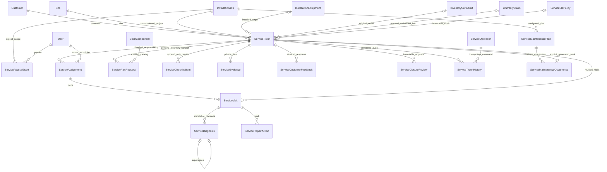
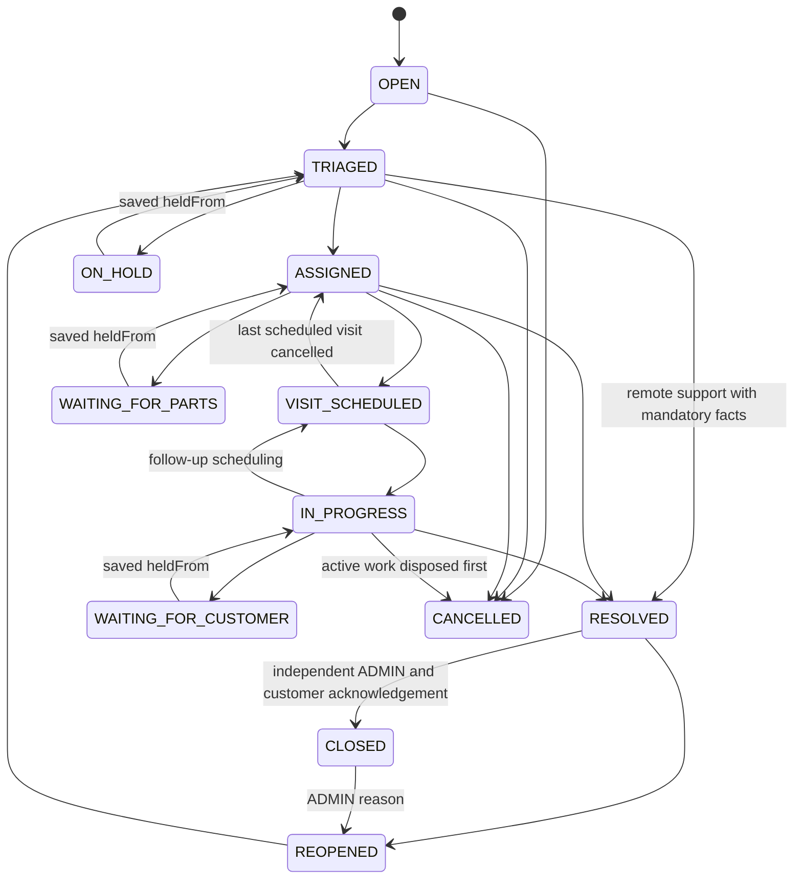
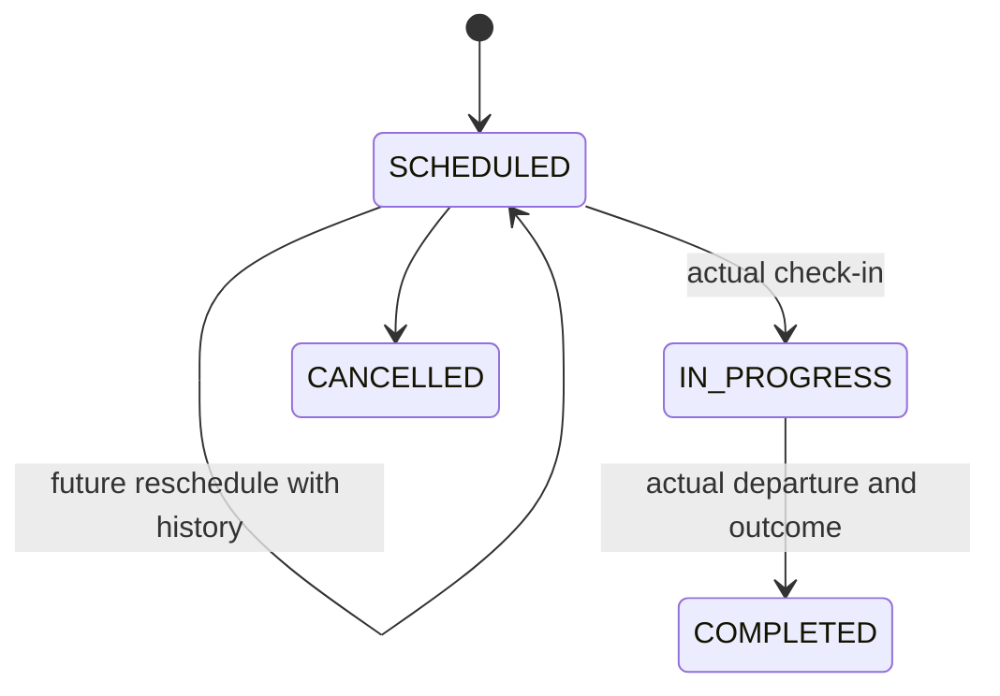
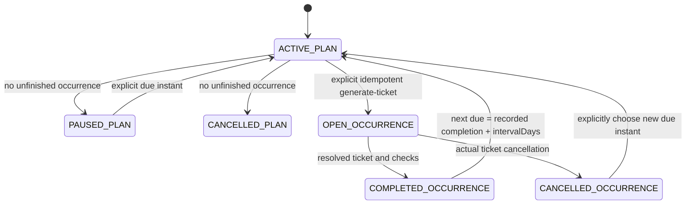

# M08 service and maintenance technical documentation

## Dependency and workflow

M06 PR6 and M07 PR7 remain unmerged. M08 starts at M07 head d7ac3e2b9ae39a68b9b76c4f8342f36bc4143a4f, retaining both modules, and targets codex/m07-warranty-management. Main advanced to4160e51 with independently maintained frontend finance/dashboard commits. M08 does not import/edit those frontend files or implement their backend modules. Preserve them when eventually incorporating main after dependencies merge; do not present unmerged M06/M07 as an M08 main PR.

An internal coordinator receives an actual complaint, selects an existing commissioned installation and optional exact installed equipment/original serial, captures authorized warranty context, triages impact/priority/safety/skills/checks, records actual first communication, assigns an existing technician and obtains acknowledgement. Timed visits use the M06 calendar/qualification/conflict engine. Technician observations, diagnosis revisions, actual attendance, repair outcomes and private evidence remain distinct from the customer's unverified report. Multiple visits support follow-up. Physical parts fulfillment is pending M04 handoff. Technical resolution requires disposed mandatory work; staff records actual customer acknowledgement and an independent ADMIN reviews closure. Explicit reopening starts a new work cycle without erasing history or resetting the original SLA.

## Models and ownership

Sixteen new models; seven new enums plus SERVICE added to existing WorkforcePurpose. No competing customer/catalog/technician/calendar/stock master.

UUID/FK ownership is restrictive. Site/customer and installed equipment/project are composite-bound; visit assignment includes exact ticket/user; diagnosis/repair/evidence visit FKs include ticket. Optional original serial is checked against actual installed M05 serial links, not a posted string. Claim links must concern the same installation and selected item, unless project-wide workmanship. Diagnosis/repair target is the ticket's immutable equipment context; another item uses another ticket. Duplicate HTTP retries are suppressed, while distinct complaints about the same item remain valid.

ServiceAccessGrant binds the issued role (SUPPORT or WAREHOUSE), preventing a later role change from widening scope without regrant. It is independent per-project authorization for active SUPPORT/WAREHOUSE, issued/revoked by ADMIN. ServiceOperation stores actor/key/hash/reason/frozen result, not another authentication credential. ServiceTicketHistory atomically records every ticket mutation; plan/SLA/access setup audit uses immutable operation results and reasons. Diagnosis revisions append linked rows; checklist/feedback use ticketVersion to choose the latest logical observation even when timestamps tie. Closure snapshots preserve exact reviewed ticket version, feedback, visits, repairs and checks.

## Ticket state machine

The exact central graph also allows the three hold states from TRIAGED/ASSIGNED/VISIT_SCHEDULED/IN_PROGRESS and cancellation from supported nonterminal work states. Resume restores the saved origin; no client status PATCH exists. Holds require no active visit and keep the SLA clock running. Critical priority implies safety concern, required physical work/checks and qualified human review; flags persist, escalation invalidates prior safety review. Internal ADMIN safety review is not regulatory certification or electrical authorization.

Resolution requires first actual response; safety review when flagged; no scheduled/running visits, planned/running/follow-up repairs or pending parts; current-cycle completed visit if required; latest completed visit without follow-up; every required checklist result PASS; and real current-cycle evidence. NOT_APPLICABLE cannot waive required work. Remote/general support may omit a physical visit only after explicit triage. Closure additionally requires latest staff-attested customer acknowledgement, all four review checks and ADMIN who has not recorded technical resolution. Customer refusal remains resolved/pending review, never fabricated acceptance.

Reopening increments executionRevision, clears current resolution/closure and requires new-cycle work/checks/evidence/feedback. Previous records and immutable reviews remain historical. Original first response and SLA targets remain. Finalized completed maintenance cannot silently reopen: create a new complaint. Cancellation disposes visits/running work/pending parts explicitly and preserves records. Current technician authorization ends when assignment ends on closure/cancellation; there is no inferred global historical access.

## Visit, diagnosis and repair lifecycle

One active assignment/ticket; many visits. Assignment identity/history freezes, acknowledgement belongs to the actual technician, reassignment ends the old row only after active visits are disposed. Scheduling requires a future positive window ≤7days and acknowledgement. Check-in records server time inside the booking; no GPS/travel proof exists. CONFIRMED access requires safety measures; DENIED records attempted attendance without allowing technical work and must retain follow-up. Completion records actual work/outcome/evidence and server departure; confirmed access requires observed diagnosis and no unfinished visit repairs. Actual minutes are derived only from recorded arrival/departure, never scheduled duration.

Diagnosis stores reported versus observed symptoms, method, explicit recorded decimal measurements/units/requirement reference, finding, probable cause/uncertainty, actual assigned technician, actor audit and evidence. Same-visit/cycle supersedesId appends a revision; old diagnosis cannot update/delete. No diagnosis AI, automatic thresholds or manufacturer confirmation is asserted.

Repairs: PLANNED -> IN_PROGRESS -> COMPLETED; PLANNED -> CANCELLED. Explicit outcome/evidence and followUpRequired represent actual work, not an invented success. Completed follow-up actions can be explicitly reworked by ADMIN into a current running visit; before/after outcomes remain in history. New repair starts revalidate current M06/triage qualifications and cannot start past booked end. Checkout and recording already observed results remain possible after overrun/qualification expiry. Component replacement execution is blocked while inventory fulfillment is unsupported; original M05 equipment history is never rewritten.

## M06 scheduling integration

Existing M06 User locks, qualifications, effective calendars/shifts/leave/blocks, managed versus legacy policy and actual M02/M05 source commitments remain canonical. availability.service extends SourceOptions with service visit/ticket exclusions, queries actual active ServiceVisit intervals, includes active untimed ServiceAssignment obligations in uncertainty/capacity, and counts overdue running visits explicitly. SERVICE becomes a sixth purpose; M06 catalog validation permits six distinct purposes. Configured SERVICE mandatory policy must exist before managed service scheduling can be confirmed. Ticket-specific required skills additionally need active catalog, verified skill levels and full-window verified certifications, including legacy cases when explicitly configured.

Managed visits require fully covered intervals, capacity, current qualifications and no conflicting work/rest/leave/block/uncertainty. Coarse installation-span planning does not apply to SERVICE. Legacy work may be manually planned only with explicit uncertainty acknowledgement/notes and confirmedAvailability=false; safety-related work requires managed verified staffing. Assignment without a timed visit is never confirmed availability. M06 schedule/profile/qualification changes revalidate future service commitments using the same engine; overdue physical work blocks new commitments. Teams remain metadata, not ticket authorization or automatic crew expansion.

Additive SQL uses GiST active-visit overlap exclusion and one-running-visit uniqueness. Shared User locking coordinates M08 visits and new companion M02/M05 conflict triggers. M06's existing has_work function is extended to service intervals/overdue work, so leave/blocks cannot ignore service. New guards prevent disabling a technician with active service assignments. Original M01–M07 migration files are unchanged; M08 migration adds these hooks. Managed calendars/full qualification interpretation remain application checks, not falsely duplicated SQL calendar rules.

## M07 warranty and M04 parts

M05 commissionedRecord validates actual commissioned job/review/equipment in the M08 creation transaction. M07's coverage method now delegates to transaction-aware coverageIn, preserving its original public authorization/payload. M08 calls this with the actual actor and same transaction; no fake ADMIN principal or scope bypass. Creation/triage captures authorized original policy/period/status/limited claim-history context. Missing M07 scope is explicit unavailable context, never absence of coverage. Current authorization also gates stored context reads. Optional existing claim link requires separate M07 case grant and same item/project. No claim is automatically created, approved or transitioned.

M04 dispatch is full installation BOM reservation/dispatch; there is no service-spares issue/replacement contract. M08 therefore records only PENDING_HANDOFF parts requests and explicit ADMIN cancellation with disposition, all as Decimal quantities against SolarComponent. No ServicePartUsage, issued/consumed/returned fiction, direct stock decrement, fabricated dispatch or replacement serial installation occurs. Scoped warehouse visibility exposes requests without private technical cases. Pending handoff blocks resolution. Physical fulfillment, unused/removed parts reconciliation and any verified replacement-installation trace require a later explicitly authorized M04/M08 integration, not M09 implementation.

## SLA and preventive maintenance

SLA policy rows are immutable explicit reference/revision configurations, selected by ID and effective category/priority/opening time; no default promise/automatic latest selection. Revision publication is sequential per reference with uniqueness/Serializable conflict handling. Targets are explicit response/resolution minutes and terms. Clock is ELAPSED_UTC_NO_PAUSE: elapsed minutes from original server openedAt, including weekends/holidays/holds/reopens. No business-hours calendar, local-time/DST pause engine or notification job is claimed. Late policy binding still computes from original opening, not triage. Escalation/reclassification preserves existing targets/snapshot. First response requires an observed attested communication timestamp, not automatic triage time. Breach is computed against actual fact or now; missing policy yields null, not compliant. Cancellation is flagged separately and excluded from unresolved counts. Summary is operational M08 counts, not M10 analytics.

Maintenance intervals/checks are configured by ADMIN, not inferred manufacturer obligations. One unfinished occurrence/plan and unique(planId,dueAt) prevent duplicate generation. Each ticket belongs to one occurrence; completion is recorded only after actual technical resolution/closure. Next interval uses UTC completion + intervalDays (1..3650), not an assumed monthly/legal interval. Cancelled occurrences remain historical; same due instant cannot regenerate. Finalized occurrence outcome cannot rewrite. No recurring scheduler, fabricated maintenance visits or notification delivery runs. Responsible users are assigned on the generated ticket.

## Authorization, concurrency, storage and limits

ADMIN full coordination/configuration/independent review; SUPPORT explicit M08 project grants; TECHNICIAN current ticket assignment/own visits; SALES M01-scoped list/summary; WAREHOUSE separately granted request visibility; FINANCE closed outcome references. M07 grants remain distinct. No public customer portal, new identity/role, private claim file access or global technician access.

Strict Zod validation, cookie/Origin/CSRF, Prisma Serializable helper, conditional versions, global actor-bound command hash/key with unique constraint, authorization before replay, restrictive/composite FKs, immutable snapshots/history and explicit409 conflicts are reused. Ticket writes lock ticket before User/child work; rescheduling/reassignment locks relevant Users in sorted order. Plan commands lock plan before ticket/occurrence; workforce updates lock User and revalidate source reads. No external network call is made inside these DB transactions. Serialization/deadlock/timeout conflicts remain possible and require deliberate refresh/retry; static review does not prove runtime race safety.

Private evidence reuses LocalSurveyStorage/validateFile under separate SERVICE_STORAGE_DIR outside repository/public/build (default ~/.solar-installation/service-uploads), size default5MiB/max10MiB. Auth/scope/version preflight precedes raw bounded parsing; second transaction rechecks owner/version/limits. Safe opaque keys, MIME/signatures, checksum/actor/time, protected integrity-checked attachment/CSP downloads; no public path/storageKey. Known rollback discards only the just-created object; unknown commit retains it with reconciliation event. Signatures are not malware scanning. Production needs approved ACLs/scanning/retention/backups/orphan handling; static checks create no evidence files.

Business-purpose private fields: customer report/impact, diagnosis/repair/feedback/evidence are case-scoped; SALES/WAREHOUSE/FINANCE receive narrow summaries. Operation/audit snapshots retain intentional case history; logs contain event/type rather than case content. Operator-approved retention/export/correction and backup policies are still required; no claim of automated privacy erasure is made.

Bounds:100 visits,200 diagnosis revisions,100 repairs,100 parts requests,300 checklist entries,100 evidence objects per ticket; ten uploads/15minutes. M06 underlying record caps and 5s interactive transaction timeout remain; large cases/crews need separately reviewed batching/load tests. Closure snapshots are bounded by those limits. Lists paginate; latest required checks/feedback use logical ticketVersion rather than timestamp ties. No new dependency or frontend file is changed.

## Verification and sources

Prisma generation/validation, strict backend typecheck/build, offline schema-to-schema migration generation, SQL/source/Git review and frontend preservation are static checks. Migration20261031000800_m08_service_management is **NOT APPLIED**. No servers, migration/reset/seed, runtime/unit/E2E test or sample business records were executed. SQL/PLpgSQL syntax/execution, cross-module races/deadlocks/rollback, scheduling/ICU/time boundaries, private storage/ACLs, role revocation/Origin/CSRF and actual API/frontend integration remain runtime-unverified.

Constraint/isolation design was checked against primary [PostgreSQL constraints documentation](https://www.postgresql.org/docs/current/ddl-constraints.html) and [transaction isolation documentation](https://www.postgresql.org/docs/current/transaction-iso.html). Cross-row checks use FKs/indexes/exclusions/triggers and application transactions rather than pretending a row CHECK validates unrelated data. Operator runtime review remains necessary. Stop after M08.

M08 warranty selection retains exact selected equipment/original serial plus project workmanship context; it never treats workmanship as guaranteed equipment-failure coverage. Whole-project tickets use project context. The internal coverage reader accepts this optional filter without changing existing M07 public endpoint behavior. Capture is capped100 matching registrations and exposes coverageTruncated; existing context pagination/claim-history truncation remain explicit.
