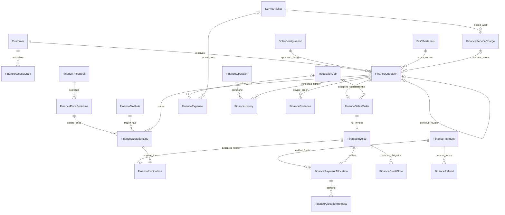
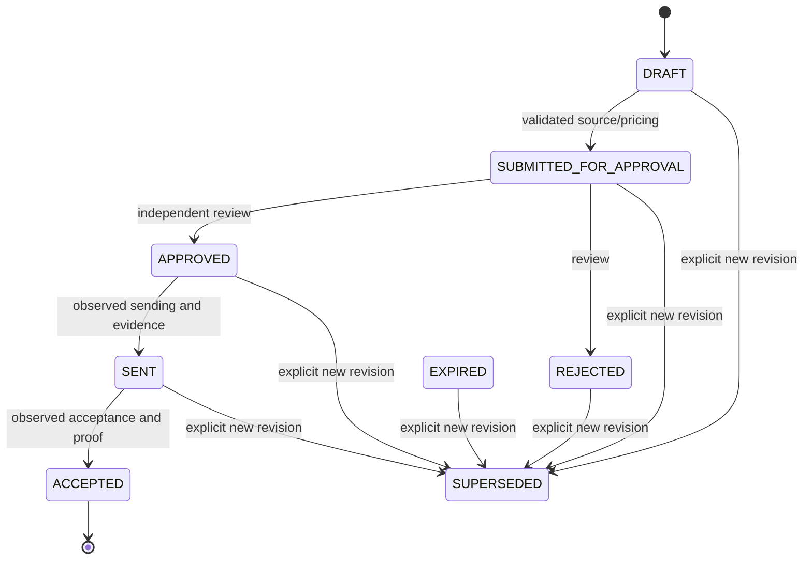

# M09 finance technical documentation

Scope: approved-design/service pricing → independently approved quotation → evidenced customer acceptance → commercial order → invoice → verified manual receipt/allocation. Corrections use explicit credit/release/reversal and independently authorized observed refunds. Costs are documented actual expenses. [API/types/routes](../integration/M09_FRONTEND_API_CONTRACT.md), [code](M09_FINANCE_CODE_EXPLANATION.md), [verification](../M09_VERIFICATION.md).

## Data and dependencies

M01–M08 are merged in main269ad2bae2bcd8654e431bcee07b80ab5c41fbd2, including Abisha's frontend finance/dashboard. New migration `20261031000900_m09_finance_accounting` was generated offline and supplemented with reviewed SQL guards, NOT APPLIED. Earlier migrations unchanged. UUIDs, real restrictive FKs, scope/project/status/reference indexes, Decimal24,2 totals and bounded quantity/price/rate precision are in schema. Supported INR/USD/EUR/GBP use2 decimals, no FX.

History/evidence have corresponding real FKs for other supported financial owners; exact-one checks prevent crossed ownership. Office expense may omit customer/project. Site snapshot is explicitly PROJECT_SITE_NOT_VERIFIED_STATUTORY_BILLING_ADDRESS; no billing address/GSTIN invented. Pricebook lineCount seals immutable line set. Quote revisions are separate linked rows, not duplicated revision tables. All19 models/10 enums and exact scalar fields appear in API appendix.

## Lifecycle

Eligible preacceptance revisions may explicitly CANCEL; EXPIRE requires elapsed validity. Non-draft cancel/expire requires FINANCE/ADMIN. Accepted/cancelled/superseded cannot revise. New revision has separate snapshot/history. Unique accepted commercialKey prevents incompatible commitments. Order is immutable CONFIRMED commercial meaning, with only one-time exact installation link allowed to advance its version.

| Entity | Workflow |
|---|---|
| Invoice | DRAFT→ISSUED; DRAFT/ISSUED→VOIDED ADMIN only, independent of issuedBy for issued, no historical allocations/credits |
| Effective invoice | CREDITED for full credit; otherwise PAID if positive obligation fully allocated; OVERDUE if balance past due; otherwise PARTIALLY_PAID/ISSUED |
| Payment | RECORDED→PENDING_VERIFICATION→VERIFIED/REJECTED; VERIFIED→REVERSED independent ADMIN/proof/no live or completed refunds |
| Credit | DRAFT→SUBMITTED→APPROVED/REJECTED; APPROVED→ISSUED; guarded unexecuted cancellation |
| Expense | DRAFT→SUBMITTED→APPROVED/REJECTED; APPROVED→RECORDED; guarded unexecuted cancellation |
| Service charge | DRAFT→SUBMITTED→APPROVED/REJECTED; guarded cancellation cannot invalidate accepted quotation |
| Refund | REQUESTED→APPROVED/REJECTED; APPROVED→COMPLETED with observed transfer/proof; guarded precompletion cancellation |

No silent reopen/edit of historical financial terms. Rejected receipts/requests remain historical. One full invoice/order is deliberate; partial/milestone/replacement invoicing and recorded-expense correction are unsupported. Do not improvise negative transactions.

## Transaction and integrity strategy

All financial writes use existing Serializable atomic utility. Authenticate role/current customer/source scope, then customer FOR UPDATE lock before mutation. Every write affecting that customer's ledger uses same lock. Multi-invoice commands sort UUIDs. Entity CAS increments version and writes exact-version history with actor/from/to/time/reason/event/details. Serialization/stale version returns409; no blind automatic retry. Office expense uses creator/ADMIN scope and own version CAS.

FinanceOperation stores unique key, canonical action/body SHA256, actor/role/reason and sanitized result. Retry replays only after current authorization and exact actor/role/action/body match. Role match prevents stale private cache leakage. Upload has no operation key: preflight and in-transaction check, ownerVersion+1 and history; uncertain retry must reconcile list/version. Allocation/release requires both invoice/payment history sharing operation and actor. Config/grants use actor-attributed versioned records/operations rather than financial entity history owners.

SQL defense includes restrictive FKs, source identity/version, tax/selling-price equations, exact-once complete BOM component pricing, immutable lines/snapshots/issued terms, accepted/order uniqueness, same-customer/currency verified allocation, bounded release, credit gross/net/tax limits, allocation plus approved/completed refund liquidity, independent qualified approval and deferred exact-version evidence/ledger audit. Deferred guards see final transaction state. Catalog sealed line count prevents later append. Database owner remains trusted; direct administrative privilege can bypass controls.

Prisma transaction timeout defaults remain unchanged. Max150 pricing lines,30 allocations/command,200 historical allocations/payment or invoice,50 evidence objects/document. Summary limit5000 invoices/20000 allocations returns409 instead of silent truncation. Contention, timeout and production performance remain unmeasured.

## Decimal rules and examples

Use Prisma.Decimal.clone precision48/ROUND_HALF_UP; convert database Decimal into clone before arithmetic. Positive money inputs≤12integer/2fraction, quantity≤9integer/3fraction, unit price≤14integer/4fraction, rate0..100≤4fraction. Persist money2dp; numeric JSON may omit trailing zeroes. No JS floating-point financial arithmetic.

Extension=round(quantity×price,2). Discount in selected price basis cannot exceed extension. Exclusive: taxable=extension−discount; tax=round(taxable×rate/100,2). Inclusive: net subtotal=extension−round(extension−extension/(1+rate/100),2); gross after=extension−entered discount; taxAfter=round(after−after/(1+rate/100),2); taxable=after−taxAfter; normalized net discount=subtotal−taxable. Header sums rounded lines; subtotal−discount+tax=total. No second document discount.

Illustrative, not executed: exclusive2×100−10 at18% gives190+34.20=224.20. Inclusive2×118−11.80 at18% gives190+34.20=224.20; normalized net discount10. Allocation100 leaves124.20. Credit50 then leaves74.20 outstanding without releasing allocation. Credit200 instead reduces obligation to24.20 and frees75.80 from that allocation into original payment's unallocated pool. Neither case sends money.

Partial credit tax=round(gross credit×original tax/original gross,2), bounded below by max(0,gross credit−remaining original net), above by min(gross credit,remaining original tax). Final full credit consumes exact remaining tax. This prevents many tiny partial credits exceeding original net or tax. Invoice outstanding=issued gross−issued credits−active verified allocations. Active allocation=original−append-only releases. Payment available=verified original−active allocations−approved refund reservations−completed refunds. Requested/rejected/cancelled refunds contribute0. Inconsistent balance throws409 rather than clamping.

Estimated margin=tax-exclusive selling taxable amount minus explicit comparable same-currency tax-exclusive estimates with source notes, only when every line has cost. Unknown margin, negative margin, excessive line discount or gross threshold requires ADMIN review. Estimates are not recognized costs. Profitability uses only explicitly installation-linked order net billed less RECORDED actual net costs, labels cost completeness NOT_ESTABLISHED and grossMargin:null; it is not accounting profit. Summaries never mix currencies, label quotations revenue, or label invoices collected cash.

## Authorization matrix

| Role | Scope |
|---|---|
| ADMIN | Global config/access and independent final high-risk reviews |
| FINANCE | Explicit active per-customer grant; office expenses creator only; operational financial actions |
| SALES | M01 customer/lead scope; commercial drafting/acceptance/orders and reads; cost/margin/sensitive snapshots/order snapshot/history details and reason redacted |
| SUPPORT | Active M08 SUPPORT installation access; charge requests/status/evidence only |
| TECHNICIAN/WAREHOUSE | Finance router denied |

Quote preparer/editor cannot review; sensitive quote ADMIN only. Receipt recorder cannot verify/reverse. Credit/expense/refund requester cannot self-approve and require ADMIN. Service charge requester cannot approve; scoped FINANCE/ADMIN review. Issued void ADMIN different from issuer. Refund completion excludes requester; approver may record observed transfer. Current authorization is rechecked before idempotent replay.

## Evidence and operational boundaries

Raw JPEG/PNG/PDF uses existing M02 byte validator/storage, separate private FINANCE_STORAGE_DIR outside repo/public/build,5MiB default/max10MiB,50 objects/owner and10 uploads/15min limiter. Metadata includes original owner/version/type/uploader/time/hash, no public path. Downloads enforce owner scope, attachment/CSP and SHA256/length. Known rollback discards newly created object; uncertain commit outcome retains bytes and logs reconciliation requirement. Private ACLs/backup/retention/scanning/orphan reconciliation remain operator tasks. Type/signature/hash checks do not certify malware safety or proof authenticity. Never submit PAN/CVV/PIN in references/text/files.

M01 supplies real parties/site/lead and SALES scope. M02/M03 supply current technical approval/BOM. M04 costs/dispatch are not automatic selling prices, expenses or delivery proof. M05 creation/commissioning is unchanged: optional commercial handoff does not retroactively gate old jobs. M06 schedule is not labor expense. M07 warranty does not determine charges. M08 exact technical closure supports independently approved nonparts fees, never pending spare consumption. No source state/history rewritten; M10 excluded.

All9 migrations require separate authorized review/deployment; this task applies none and creates no data/catalog/grants. Static checks do not prove SQL execution, live auth/CSRF, money edge cases, races, file rollback/load or statutory suitability. No gateway/general ledger/GST/bank reconciliation/payroll/subsidy/FX claim.

References: [Decimal.js clone/rounding](https://mikemcl.github.io/decimal.js/), [PostgreSQL constraints](https://www.postgresql.org/docs/current/ddl-constraints.html); actual Prisma behavior follows pinned local6.19.3 generated types.
